# EventFlow — تقرير مشروع التخرج

## الغلاف

الجمهورية اليمنية  
وزارة التربية والتعليم والبحث العلمي  
جامعة الجيل الجديد  
كلية الهندسة وتقنية المعلومات  
قسم علوم الحاسوب

| الجهة | الشعار |
| --- | --- |
| الجمهورية اليمنية — وزارة التربية والتعليم والبحث العلمي — جامعة الجيل الجديد — كلية الهندسة وتقنية المعلومات — قسم علوم الحاسوب | `[بحاجة إلى استكمال: توضيح البيانات المطلوبة هنا]` |

# EventFlow

**An Integrated Web-Based Event Management System**

**EventFlow: نظام متكامل لإدارة الفعاليات**

**تقرير مشروع التخرج**

| اسم الطالب | الرقم الجامعي |
| --- | --- |
| `[بحاجة إلى استكمال: توضيح البيانات المطلوبة هنا]` | `[بحاجة إلى استكمال: توضيح البيانات المطلوبة هنا]` |
| `[بحاجة إلى استكمال: توضيح البيانات المطلوبة هنا]` | `[بحاجة إلى استكمال: توضيح البيانات المطلوبة هنا]` |
| `[بحاجة إلى استكمال: توضيح البيانات المطلوبة هنا]` | `[بحاجة إلى استكمال: توضيح البيانات المطلوبة هنا]` |
| `[بحاجة إلى استكمال: توضيح البيانات المطلوبة هنا]` | `[بحاجة إلى استكمال: توضيح البيانات المطلوبة هنا]` |
| `[بحاجة إلى استكمال: توضيح البيانات المطلوبة هنا]` | `[بحاجة إلى استكمال: توضيح البيانات المطلوبة هنا]` |

**تحت إشراف:** `[بحاجة إلى استكمال: توضيح البيانات المطلوبة هنا]`

**العنوان الأكاديمي:** `[بحاجة إلى استكمال: توضيح البيانات المطلوبة هنا]`

**العام الجامعي:** `[بحاجة إلى استكمال: توضيح البيانات المطلوبة هنا]`

---

## الملخص

يمثل EventFlow نظاماً متكاملاً قائماً على الويب لإدارة الفعاليات، صُمّم لمعالجة التشتت الناتج عن الاعتماد على الطرق اليدوية والجداول المنفصلة في تخطيط المؤتمرات والورش والأنشطة الجامعية، وفق ما ورد في وثائق التحليل والمقترح ضمن المستودع. يستند النظام إلى نموذج بيانات علائقي واحد يربط المستخدمين والفعاليات والجلسات والتسجيلات والتذاكر والحضور والتقييمات والتكاليف والإشعارات، ويخدم ثلاثة أدوار رئيسية هي المشارك `attendee` والمنظم `organizer` والمسؤول `admin`، مع إتاحة تصفح عام للزائر غير المسجل.

تتمثل المشكلة التي عالجها المشروع في صعوبة متابعة التسجيلات وقوائم الانتظار، وغياب تذكرة رقمية قابلة للتحقق آلياً، وتشتت قنوات التواصل بين المنظم والحاضرين، وضعف مؤشرات الحضور والتكاليف ورضا المشاركين. وقد استهدف المشروع بناء منصة واحدة تغطي دورة حياة الفعالية من الإنشاء والنشر، مروراً بالتسجيل وإصدار التذاكر، وصولاً إلى فحص الحضور وجمع التقييمات وإصدار التقارير.

تحققت أهداف المشروع من خلال وحدات فعلية مدعومة بالشيفرة والمخطط القاعدي: إدارة الحسابات والمصادقة عبر دوال `SECURITY DEFINER`، وإدارة الفعاليات بصيغتيها الحضورية والإلكترونية، وقوائم الانتظار مع الترقية التلقائية، وتذاكر تحمل رموز `QR` فريدة، وفحص دخول وانصراف بالمسح الضوئي، وجلسات ومتحدثون، واستبيانات تقييم، ومحادثات عامة وخاصة مدعومة بـ Realtime، وإشعارات داخلية، ولوحات مؤشرات وتقارير قابلة للتصدير، وضوابط أمن تشمل `RLS` وسجل تدقيق وحدوداً لمحاولات الدخول.

اعتمد التنفيذ على React 19 وTypeScript وVite 8 وTailwind CSS 4 وRadix UI في الواجهة، وعلى Supabase وPostgreSQL في الخلفية، مع Recharts للرسوم، و`qrcode` و`html5-qrcode` للتذاكر، وXLSX وjsPDF للتصدير، وVitest للاختبارات الآلية. وتُستند النتائج إلى أدلة فعلية من المستودع وسجلات اختبار محلية، مع التمييز الصريح بين المنفَّذ وما زال قيد التطوير أو خارج النطاق.

تكمن أهمية المشروع في توفير نموذج قابل للتخصيص للمؤسسات التعليمية، يوحّد بيانات الفعالية في مصدر واحد، ويقلل الأعمال اليدوية، ويدعم اتخاذ القرار بمؤشرات موثقة، مع الحفاظ على خصوصية المستخدمين وسياسات الوصول على مستوى الصفوف. ويخلص التقرير إلى أن الأهداف التسعة تحققت على مستوى التنفيذ، وأن 12 ملف اختبار آلي تضم 95 حالة قد نجحت عند تشغيلها محلياً، مع الإبقاء على سيناريوهات القبول الـ26 دون نتائج مفترضة، وعدم ادعاء قياسات أداء أو لقطات شاشة غير متوفرة في المستودع.

---

## التفويض

أقرّ الموقّعون أدناه بأن هذا المشروع أُنجز ضمن متطلبات مشروع التخرج في قسم علوم الحاسوب — كلية الهندسة وتقنية المعلومات — جامعة الجيل الجديد، وبأن جميع المصادر التي استُخدمت في إعداده قد أُشير إليها في قائمة المراجع وفق تنسيق IEEE. كما يفوّضون الكلية الاحتفاظ بنسخة منه واستخدامها لأغراض التوثيق الأكاديمي والتقييم.

| Student Name | Student No. | Signature | Date |
| --- | --- | --- | --- |
| `[بحاجة إلى استكمال: توضيح البيانات المطلوبة هنا]` | `[بحاجة إلى استكمال: توضيح البيانات المطلوبة هنا]` |  |  |
| `[بحاجة إلى استكمال: توضيح البيانات المطلوبة هنا]` | `[بحاجة إلى استكمال: توضيح البيانات المطلوبة هنا]` |  |  |
| `[بحاجة إلى استكمال: توضيح البيانات المطلوبة هنا]` | `[بحاجة إلى استكمال: توضيح البيانات المطلوبة هنا]` |  |  |
| `[بحاجة إلى استكمال: توضيح البيانات المطلوبة هنا]` | `[بحاجة إلى استكمال: توضيح البيانات المطلوبة هنا]` |  |  |
| `[بحاجة إلى استكمال: توضيح البيانات المطلوبة هنا]` | `[بحاجة إلى استكمال: توضيح البيانات المطلوبة هنا]` |  |  |

---

## الإهداء

إلى الوالدين الكريمين اللذين كانا السند الأول في مسيرة التعليم، وإلى أعضاء هيئة التدريس الذين لم يبخلوا بالنصح والتوجيه، وإلى زملاء الدراسة الذين شاركوا في رحلة التحليل والتصميم والتنفيذ.

وإلى كل من آمن بأن التنظيم الرقمي للفعاليات يمكن أن يحوّل العمل اليدوي المتفرق إلى تجربة واضحة وموثوقة تخدم المنظم والحاضر على حد سواء.

---

## الشكر والتقدير

الحمد لله أولاً وآخراً الذي وفّقنا لإتمام هذا العمل، والشكر موصول لجامعة الجيل الجديد وكلية الهندسة وتقنية المعلومات وقسم علوم الحاسوب على توفير البيئة الأكاديمية الداعمة.

نتقدم بخالص الشكر والتقدير إلى المشرف الأكاديمي على متابعته المستمرة وملاحظاته التي أثرت التحليل والتصميم، وإلى لجنة الحكم والمناقشة على وقتها وجهودها في مراجعة هذا التقرير.

كما نشكر كل من قدّم دعماً تقنياً أو معنوياً، وكل من ساهم في اختبار النظام أو توفير التغذية الراجعة التي ساعدت في تحسين جودة المخرجات النهائية.

---

## إقرار المشرف

أشهد بأن هذا التقرير الموسوم بـ «نظام متكامل لإدارة الفعاليات — EventFlow» قد أُنجز بواسطة فريق الطلبة الموضح أدناه تحت إشرافي، وبأنه روجع من حيث البنية العلمية واللغة والتنسيق، وبأنه مطابق لهيكل التوثيق المعتمد لجامعة الجيل الجديد، وبأنه صالح للمناقشة أمام لجنة الحكم.

| Student Name | Student No. | Signature | Date |
| --- | --- | --- | --- |
| `[بحاجة إلى استكمال: توضيح البيانات المطلوبة هنا]` | `[بحاجة إلى استكمال: توضيح البيانات المطلوبة هنا]` |  |  |
| `[بحاجة إلى استكمال: توضيح البيانات المطلوبة هنا]` | `[بحاجة إلى استكمال: توضيح البيانات المطلوبة هنا]` |  |  |
| `[بحاجة إلى استكمال: توضيح البيانات المطلوبة هنا]` | `[بحاجة إلى استكمال: توضيح البيانات المطلوبة هنا]` |  |  |
| `[بحاجة إلى استكمال: توضيح البيانات المطلوبة هنا]` | `[بحاجة إلى استكمال: توضيح البيانات المطلوبة هنا]` |  |  |
| `[بحاجة إلى استكمال: توضيح البيانات المطلوبة هنا]` | `[بحاجة إلى استكمال: توضيح البيانات المطلوبة هنا]` |  |  |

**Supervisor:** `[بحاجة إلى استكمال: توضيح البيانات المطلوبة هنا]`

**Academic title:** `[بحاجة إلى استكمال: توضيح البيانات المطلوبة هنا]`

**Date:** `[بحاجة إلى استكمال: توضيح البيانات المطلوبة هنا]`

---

## لجنة الحكم والمناقشة

أُجيز هذا التقرير بعد مناقشته أمام لجنة الحكم والمناقشة بتاريخ `[بحاجة إلى استكمال: توضيح البيانات المطلوبة هنا]`، وفق قرار مجلس الكلية رقم `[بحاجة إلى استكمال: توضيح البيانات المطلوبة هنا]`، ويوصى بإيداعه في مكتبة الكلية.

| No. | Name | Position | Signature |
| --- | --- | --- | --- |
| 1 | `[بحاجة إلى استكمال: توضيح البيانات المطلوبة هنا]` | Supervisor |  |
| 2 | `[بحاجة إلى استكمال: توضيح البيانات المطلوبة هنا]` | Internal Examiner |  |
| 3 | `[بحاجة إلى استكمال: توضيح البيانات المطلوبة هنا]` | External Examiner |  |
| 4 | `[بحاجة إلى استكمال: توضيح البيانات المطلوبة هنا]` | Head of Department |  |

---

## فهرس المحتويات

1. الفصل الأول: المقدمة
   - 1.1 نظرة عامة على المشروع
   - 1.2 صياغة المشكلة
   - 1.3 أهداف المشروع
   - 1.4 نطاق المشروع والقيود
   - 1.5 منهجية المشروع
   - 1.6 تنظيم التقرير
2. الفصل الثاني: الخلفية النظرية والدراسات السابقة
   - 2.1 الخلفية النظرية
   - 2.2 الدراسات والأعمال السابقة
   - 2.3 مقارنة الأنظمة الحالية
   - 2.4 التقنيات المستخدمة
   - 2.5 ملخص الفصل
3. الفصل الثالث: تحليل المتطلبات والنمذجة
   - 3.1 مقدمة
   - 3.2 أصحاب المصلحة وأدوار المستخدمين
   - 3.3 المتطلبات الوظيفية
   - 3.4 المتطلبات غير الوظيفية
   - 3.5 نمذجة حالات الاستخدام
   - 3.6 نمذجة البيانات ومخطط ERD
   - 3.7 مخططات التسلسل
   - 3.8 مخططات الأنشطة
   - 3.9 مخططات الحالات
   - 3.10 مصفوفة تتبع المتطلبات
4. الفصل الرابع: تصميم المشروع
   - 4.1 مقدمة
   - 4.2 معمارية النظام
   - 4.3 تصميم قاعدة البيانات
   - 4.4 تصميم الواجهة الخلفية
   - 4.5 تصميم الواجهة الأمامية
   - 4.6 تصميم الأمان
   - 4.7 تصميم واجهة المستخدم وتجربتها
   - 4.8 الخوارزميات ومنطق الأعمال
   - 4.9 ملخص الفصل
5. الفصل الخامس: التنفيذ والاختبار
   - 5.1 مقدمة
   - 5.2 بيئة التطوير والأدوات
   - 5.3 تنفيذ الوحدات الرئيسية
   - 5.4 تنفيذ قاعدة البيانات
   - 5.5 تنفيذ الأمان
   - 5.6 استراتيجية الاختبار
   - 5.7 حالات الاختبار والنتائج
   - 5.8 النشر
   - 5.9 ملخص الفصل
6. الفصل السادس: النتائج والمناقشة
   - 6.1 مقدمة
   - 6.2 استعراض النظام بحسب الدور
   - 6.3 تحقق أهداف المشروع
   - 6.4 النتائج مقابل المتطلبات
   - 6.5 مناقشة الأداء وقابلية الاستخدام
   - 6.6 مناقشة الأمان والموثوقية
   - 6.7 القيود
   - 6.8 المناقشة
   - 6.9 ملخص الفصل
7. الفصل السابع: الخاتمة والتوصيات
   - 7.1 الاستنتاجات
   - 7.2 التوصيات والأعمال المستقبلية
   - 7.3 ملخص الفصل
8. المراجع
9. الملاحق A–H

---

## قائمة الأشكال

- **Figure 3-1: EventFlow Core Use Case Diagram**
- **Figure 4-1: EventFlow System Architecture**
- **Figure F-1: Project Timeline (Gantt Chart)**

---

## قائمة الجداول

- **Table 2-1: Feature Comparison of EventFlow and Representative Alternatives**
- **Table 2-2: EventFlow Technology Stack**
- **Table 3-1: EventFlow User Roles and Main Permissions**
- **Table 3-2: Functional Requirements Summary**
- **Table 3-3: Non-Functional Requirements and Implementation Evidence**
- **Table 3-4: Main EventFlow Data Entities**
- **Table 3-5: Main Event, Registration and Ticket States**
- **Table 3-6: Requirements Traceability Summary**
- **Table 4-1: Core Database Tables**
- **Table 5-1: Development and Testing Tools**
- **Table 5-2: Representative Test Cases**
- **Table 6-1: Project Objectives and Delivered Features**
- **Table 6-2: Requirement Coverage Summary**
- **Table A-1: Attendee Tasks and Steps**
- **Table A-2: Organizer Tasks and Steps**
- **Table A-3: Administrator Tasks and Steps**
- **Table B-1: Core Tables, Keys and Relationships**
- **Table C-1: Database Functions and Their Responsibilities**
- **Table C-2: Chatbot Request and Response Fields**
- **Table D-1: Detailed Test Case Matrix**
- **Table E-1: Demo Accounts Created by the Seed Script**
- **Table G-1: Key Source Files and Responsibilities**
- **Table H-1: Security Controls and Implementation Evidence**
- **Table H-2: Database Migration Checklist**

---

## قائمة الاختصارات

| الاختصار | التعريف |
| --- | --- |
| API | واجهة برمجة التطبيقات |
| CRUD | العمليات الأساسية: إنشاء، قراءة، تعديل، حذف |
| CSS | أوراق الأنماط المتتالية لتنسيق واجهات الويب |
| ERD | مخطط العلاقات بين الكيانات |
| FR | متطلب وظيفي |
| HTML | لغة ترميز النصوص التشعبية |
| IEEE | معهد مهندسي الكهرباء والإلكترونيات |
| JWT | رمز وصول JSON المستخدم في أنظمة المصادقة |
| KPI | مؤشر أداء رئيسي |
| NFR | متطلب غير وظيفي |
| PDF | تنسيق المستندات المحمول |
| QR | رمز الاستجابة السريعة |
| RBAC | التحكم في الوصول القائم على الأدوار |
| RLS | أمان مستوى الصفوف في قاعدة البيانات |
| RPC | استدعاء إجراء عن بُعد |
| SPA | تطبيق صفحة واحدة |
| SQL | لغة الاستعلامات البنيوية |
| UI | واجهة المستخدم |
| UML | لغة النمذجة الموحدة |
| UX | تجربة المستخدم |
| XLSX | تنسيق مصنف Excel المفتوح |
| CSV | قيم مفصولة بفواصل |

---

## الرموز الرياضية

| الرمز | المعنى المستخدم في التقرير |
| --- | --- |
| C | السعة القصوى للفعالية |
| R | عدد التسجيلات المؤكدة |
| W | عدد المسجلين في قائمة الانتظار |
| A | عدد الحاضرين المسجلين فعلياً |
| AR | معدل الحضور = A / R |
| sᵢ | الجلسة الفرعية i داخل برنامج الفعالية |
| n | عدد الجلسات أو عدد عناصر المجموعة |
| S | مجموعة الجلسات |
| E | مجموعة الفعاليات |
| Ac | التكلفة الفعلية مقابل المخططة |
| V | صلاحية التذكرة: `valid` أو `used` أو `invalid` |
| p | نسبة إشغال المقاعد = R / C |

---

## الفصل الأول: المقدمة

**Chapter 1**

**Introduction**

*Graduation Project Report*

---

### 1.1 نظرة عامة على المشروع

تهدف إدارة الفعاليات إلى تنظيم نشاط جماعي محدد زمنياً ومكانياً، بدءاً من التخطيط والإعلان، مروراً بتلقي التسجيلات وتخصيص المقاعد، وانتهاءً بتوثيق الحضور وقياس الأثر [1]. ويكتسب هذا النوع من الإدارة أهمية متزايدة في البيئات الجامعية، حيث تتعدد الفعاليات وتتنوع بين مؤتمرات وورش عمل وندوات وأنشطة طلابية، ويصبح التنسيق بين المنظمين والحاضرين عاملاً حاسماً في نجاحها.

يُعد EventFlow منصة ويب متكاملة لإدارة دورة حياة الفعالية، صُممت لتعمل كوسيط رقمي بين ثلاثة أطراف فاعلة: المشارك `attendee`، والمنظم `organizer`، والمسؤول `admin`، مع إتاحة تصفح الفعاليات العامة للزائر غير المسجل. يغطي النظام المسار الكامل للفعالية: إنشاء الفعالية وتحديد خصائصها، بناء الجدول الزمني والجلسات والمتحدثين، فتح باب التسجيل، إصدار التذاكر الرقمية، متابعة الحضور بالمسح الضوئي، جمع التقييمات والتغذية الراجعة، تسجيل التكاليف، ثم استعراض التقارير والمؤشرات.

تعتمد المنصة على نموذج بيانات علائقي واحد في PostgreSQL عبر Supabase، بحيث تُربط الفعالية بفئتها وموقعها ومنظميها وجلساتها وتسجيلاتها وتذاكرها وسجلات حضورها وتقييماتها وتكاليفها وإشعاراتها. وتُقسَّم الواجهة إلى مسار عام للتصفح والتسجيل، ومسار خاص بلوحة التحكم يتطلب المصادقة، مع حماية المسارات حسب الدور عبر `ProtectedRoute` و`PublicRoute`.

تتيح المنصة إنشاء فعاليات حضورية مرتبطة بمواقع وسعات، وفعاليات إلكترونية تُولَّد لها روابط اجتماع، إضافة إلى النمط الهجين المدعم في الثوابت. كما تدعم الفعاليات الخاصة عبر روابط دعوة تحمل رموزاً فريدة، وتتيح قنوات محادثة عامة وخاصة، وإشعارات داخلية، واستبيانات تقييم قابلة للتكوين، ولوحات مؤشرات وتقارير قابلة للتصدير إلى XLSX وPDF وCSV. ويُكمل المساعد الذكي تجربة الاستكشاف عبر استدعاء أدوات بيانات حقيقية من قاعدة البيانات.

### 1.2 صياغة المشكلة

أظهر تحليل بيئة العمل التقليدية أن إدارة الفعاليات تعتمد في كثير من الحالات على ملفات ورقية وجداول إلكترونية متفرقة ورسائل غير منظمة، مما يولّد خمس مشكلات مترابطة:

1. **تشتت المعلومات:** تتوزع بيانات الفعالية بين نماذج التسجيل وقوائم الحضور ورسائل التنسيق، فتفقد البيانات وحدتها ويصعب الرجوع إليها.
2. **ضعف التسجيل وقوائم الانتظار:** لا توجد آلية موثقة لضبط السعة، بل يُعالج تجاوز الطلبة للمقاعد المتاحة يدوياً، مما ينتج أخطاء وتكرارات وتأخيراً في إبلاغ المنتظرين.
3. **صعوبة التحقق من الحضور:** تعتمد الطريقة اليدوية على قراءة الأسماء أو أوراق التذاكر، وهو أسلوب بطيء ولا يمنع إعادة استخدام التذكرة أو تسجيل حضور غير مؤكد.
4. **ضعف التواصل والتغذية الراجعة:** لا توجد قناة رسمية موحدة بين المنظم والحاضر، ولا آلية منظمة لجمع التقييمات بعد انتهاء الفعالية، وهو ما يقلل من إمكانية تحسين الفعاليات اللاحقة.
5. **غياب المؤشرات الإدارية:** لا تتوفر أرقام موثقة عن عدد المسجلين أو معدل الحضور أو التكاليف المخططة والفعلية، فيُتخذ القرار دون أساس بياناتي.

تُضاف إلى هذه المشكلات متطلبات قابلية الاستخدام وسهولة التعلم التي أكدتها أدبيات هندسة التفاعل بين الإنسان والحاسوب [2]، ومعايير التصميم القائم على المستخدم [3]. ومن هنا جاءت الحاجة إلى نظام واحد يوحّد البيانات ويعتمد آليات آلية للتحقق والتنبيه والقياس، بدل حلول مجزأة تعالج كل مشكلة على حدة.

### 1.3 أهداف المشروع

يتمثل الهدف العام في تصميم وتنفيذ نظام ويب متكامل يدعم دورة حياة الفعالية كاملة. ويتفرع عنه تسعة أهداف مرتبطة بوحدات منفذة في المستودع:

1. إنشاء بوابة تصفح عامة تعرض الفعاليات المنشورة غير المحذوفة، وتفاصيل الفعالية والجلسات، تمهيداً للتسجيل (`Events.tsx`، `EventDetail.tsx`، `eventService.listEvents`).
2. توفير مصادقة وإدارة حسابات بثلاثة أدوار، مع تسجيل دخول وتسجيل جديد واستعادة كلمة مرور واستعادة حساب وإدارة جلسات الأجهزة (`authService.ts`، `accountService.ts`، `passwordResetService.ts`).
3. تمكين المنظم من إنشاء الفعاليات وتعديلها ونشرها وأرشفتها ونسخها وحذفها منطقياً، مع دعم الفعاليات الإلكترونية وطلبات الفعاليات (`EventForm.tsx`، `eventService.ts`، `eventRequestService.ts`).
4. أتمتة التسجيل وقوائم الانتظار والترقية التلقائية عند تحرير مقعد، مع إصدار تذكرة فريدة لكل تسجيل مؤكد (`registrationService.ts`، `ticketService.ts`، `notify_waitlist_promotion`).
5. توفير فحص حضور وانصراف عبر مسح `QR` مع التحقق من هوية التذكرة وحالتها ومنع إعادة الاستخدام (`QrScanner.tsx`، `attendanceService.ts`، `ticketCode.ts`).
6. دعم الجلسات والمتحدثين والدعوات الخاصة وإدارة الحضور اليدوي والإلكتروني (`sessionService.ts`، `invitationService.ts`، `EventMeeting.tsx`).
7. توفير تقييم قابل للتكوين ومحادثات عامة وخاصة وإشعارات داخلية فورية (`evaluationService.ts`، `chatService.ts`، `notificationService.ts`).
8. توفير لوحة مؤشرات وتقارير مع تصدير XLSX وPDF وCSV وإدارة التكاليف والحملات (`dashboardService.ts`، `reportsService.ts`، `exportService.ts`، `financeService.ts`).
9. تنفيذ ضوابط أمان قابلة للتحقق تشمل `RLS` وصلاحيات الأعمدة وتجزئة كلمات المرور وسجل التدقيق وحدود محاولات الدخول وواجهة عربية RTL (`schema-part2-security.sql`، `rateLimit.ts`، `auditService.ts`، `src/i18n/`).

### 1.4 نطاق المشروع والقيود

#### 1.4.1 النطاق المنفذ

يشمل النطاق المنفذ: إدارة المستخدمين والأدوار، والفئات والمواقع والملفات وإعدادات النظام؛ وإدارة الفعاليات بصيغها الحضورية والإلكترونية والخاصة؛ والجلسات والمتحدثين؛ والتسجيل وقوائم الانتظار والدعوات؛ والتذاكر والحضور؛ والتقييمات والتغذية الراجعة؛ والمحادثات والإشعارات؛ والتكاليف والمالية والحملات؛ ولوحات المؤشرات والتقارير؛ ومركز الأمان وسجل التدقيق؛ والتعريب إلى العربية مع دعم RTL والثيمات.

#### 1.4.2 القيود المعروفة

1. النظام هو تطبيق صفحة واحدة ولا يتضمن تطبيق جوال أصلي، وإن كانت الواجهة متجاوبة مع شاشات الهاتف.
2. لا توجد بوابة دفع إلكتروني؛ تُسجَّل التكاليف والمصادر المالية كبيانات إدارية فقط.
3. لا يعمل النظام دون اتصال بالخلفية السحابية؛ فحص التذاكر يعتمد على إرسال الرمز إلى Supabase للتحقق من الحالة.
4. المساعد الذكي في المسار الفعلي يعتمد على خادم LM Studio محلي عبر وكيل `/lmstudio`، بينما توجد دالة Edge بديلة غير مستخدمة من الواجهة الحالية.
5. لا توجد قياسات أداء إنتاجية أو اختبارات حمل موثقة ضمن المستودع، ولذلك لا يُذكر أي رقم زمني غير مدعوم بالدليل.
6. بعض بيانات الهوية الأكاديمية تُترك فارغة في هذه النسخة لعدم توفرها في المصادر.

### 1.5 منهجية المشروع

اتُّبعت منهجية تطوير متكررة تزايدية مع نمذجة موجهة للكائنات، تماشياً مع منهجيات هندسة البرمجيات التي تربط المتطلبات بالتصميم والتحقق [4]. سار العمل في ست مراحل متداخلة:

1. **فهم المتطلبات:** استخراج المشكلات من وثيقة التحليل ومقترح المشروع، وتحديد الفاعلين والأدوار.
2. **التحليل والنمذجة:** إنتاج مخطط حالات استخدام وERD ومخططات تسلسل ونشاط وحالات باستخدام PlantUML وMermaid، وربط كل مخطط بملفات الكود.
3. **التصميم:** تحديد بنية Pages إلى Services إلى Supabase، وتصميم الجداول والمفاتيح والقيود وسياسات الوصول.
4. **البناء:** تنفيذ الصفحات والخدمات والسياقات، وتطبيق مخطط SQL والهجرات، وتفعيل الترجمة والعربية.
5. **الاختبار:** تشغيل اختبارات Vitest على الخدمات والأدوات، ومراجعة نتائجها وتوثيقها، مع تمييز الحالات غير المختبرة آلياً.
6. **التوثيق:** إنتاج هذا التقرير وفق الهيكل المعتمد، ثم التحقق الآلي من البنية والأدلة.

اعتمد التحكم في الإصدار على Git، واستُخدم TypeScript المشدّد الأنواع لتقليل أخطاء التكامل بين الطبقات، بينما وفّرت المراجعات المتكررة للتصميم فرصة لتصحيح نموذج البيانات قبل التنفيذ النهائي.

### 1.6 تنظيم التقرير

يتكون التقرير من سبعة فصول ومراجع وثمانية ملاحق. يعرض الفصل الأول نظرة عامة وصياغة المشكلة والأهداف والنطاق والمنهجية. ويناقش الفصل الثاني الخلفية النظرية والدراسات السابقة ومقارنة الأنظمة والتقنيات المستخدمة. ويقدم الفصل الثالث تحليل المتطلبات والأدوار والمتطلبات الوظيفية وغير الوظيفية والنمذجة ومصفوفة التتبع. ويشرح الفصل الرابع معمارية النظام وقاعدة البيانات والواجهة الخلفية والأمامية والأمان والتصميم التفاعلي والخوارزميات. ويستعرض الفصل الخامس بيئة التنفيذ والوحدات الرئيسية وقاعدة البيانات والأمان واستراتيجية الاختبار والنتائج والنشر. ويقيم الفصل السادس النتائج مقابل الأهداف والمتطلبات ويناقش الأداء وسهولة الاستخدام والأمان والقيود. ويختم الفصل السابع بالاستنتاجات والتوصيات والأعمال المستقبلية. وتُرفق المراجع بصيغة IEEE، تليها الملاحق A–H التي تشمل دليل المستخدم وملخص قاعدة البيانات ومرجع RPC ومصفوفة الاختبارات وبيانات العرض وخطة المشروع وهيكل الشيفرة وسياسات الأمان.

**ملخص الفصل:** عرّف هذا الفصل EventFlow بوصفه منصة ويب تغطي دورة حياة الفعالية، وبيّن المشكلات التي عالجها في تشتت البيانات وضعف التسجيل والحضور والتواصل والمؤشرات، ثم صاغ تسعة أهداف مرتبطة بوحدات منفذة. كما حدد النطاق المنفذ والقيود المعروفة، وعرض منهجية تحليل وتصميم وبناء واختبار متكررة، تمهيداً لاستعراض الخلفية النظرية والدراسات السابقة في الفصل التالي.

---

## الفصل الثاني: الخلفية النظرية والدراسات السابقة

**Chapter 2**

**Background and Literature Review**

*Graduation Project Report*

---

### 2.1 الخلفية النظرية

#### 2.1.1 مفهوم إدارة الفعاليات وأهميتها

الفعالية نشاط منظم محدود زمنياً يُقام لتحقيق غرض تعليمي أو مهني أو اجتماعي. وتشمل إدارتها سلسلة من القرارات المتصلة: تحديد الجمهور المستهدف، وضبط السعة، وبناء البرنامج الزمني، وإدارة التسجيل، وتأمين الدخول، وجمع التغذية الراجعة. وتزداد أهمية التنسيق بين هذه القرارات كلما زاد عدد المشاركين وتنوعت أدوار القائمين على الفعالية.

#### 2.1.2 التحول الرقمي في إدارة الفعاليات

أدى التحول الرقمي إلى نقل بيانات الفعاليات من الورق والجداول المنفصلة إلى منصات مركزية تتيح التسجيل الذاتي والتحديث الفوري والوصول من أجهزة مختلفة. ويُعد نمط تطبيق الصفحة الواحدة أحد الأنماط الشائعة في هذا السياق، إذ يُحمّل التطبيق مرة واحدة ثم تُحدَّث أجزاؤه ديناميكياً دون إعادة تحميل الصفحة بالكامل، مما يحسن استمرارية التفاعل.

#### 2.1.3 التذاكر الرقمية والتحقق بالرموز ثنائية الأبعاد

التذكرة الرقمية هي سجل إلكتروني مرتبط بتسجيل مؤكد، يحمل معرّفاً فريداً ومعلومات تكفي للتحقق من ملكيته. ويُستخدم رمز الاستجابة السريعة كوسيط قراءة آلية؛ إذ تُشفَّر حمولة نصية تحتوي على رمز التذكرة ومعرّف الفعالية ومعرّف التسجيل، ثم تُفحص الحمولة على الخادم قبل تسجيل الحضور. ويستند تنسيق الرمز إلى المعيار الدولي ISO/IEC 18004:2015 [14]. ويمنع النظام إعادة استخدام التذكرة بتغيير حالتها من `valid` إلى `used` بعد أول فحص ناجح.

#### 2.1.4 قابلية الاستخدام وهندسة البرمجيات

تُعنى قابلية الاستخدام بمدة تعلم النظام وكفاءة أداء المهام ورضا المستخدم، وقد أكد Nielsen ضرورة اختبار الواجهة مع مستخدمين فعليين وتحليل الأخطاء المتكررة [2]. ويُكمل ذلك المعيار ISO 9241-210:2019 الذي يضع التفاعل بين الإنسان والحاسوب ضمن سياق الاستخدام وخصائص المستخدم والمهمة [3]. أما على مستوى البنية، فإن فصل طبقات العرض والخدمات والبيانات يسهل الصيانة والاختبار، وهو من المبادئ التي تناولها Sommerville في هندسة البرمجيات [4].

#### 2.1.5 الأمان ونماذج الخدمات السحابية

تعتمد المنصات الحديثة على نموذج الخلفية كخدمة الذي يوفر قاعدة بيانات ومصادقة وتخزيناً واشتراكات فورية عبر واجهات برمجة. ويفرض هذا النمط ضرورة ضبط الوصول عند الخادم، لأن العميل قد يصل إلى واجهة البيانات مباشرة. وتُعد قائمة OWASP Top 10 مرجعاً لتصنيف مخاطر تطبيقات الويب، بما في ذلك فشل التحكم في الوصول وانعدام الأمان في التصميم [7].

### 2.2 الدراسات والأعمال السابقة

تُظهر أدبيات إدارة الفعاليات أن نجاح المؤتمر لا يتوقف على البرنامج فقط، بل على جودة العمليات الداعمة: التسجيل، والتذاكر، والتواصل، والقياس [1]. كما تؤكد الأدبيات أن تقليل عدد الخطوات اللازمة لإتمام المهمة يقلل الأخطاء ويرفع رضا المستخدم [2]، وأن تصميم النظام يجب أن ينطلق من احتياجات الفاعلين لا من إمكانات التقنية [3].

من منظور هندسة البرمجيات، يوفر النمط المعماري القائم على استدعاء الإجراءات عن بُعد واجهة مستقرة بين العميل والخادم، وهو ما وصفه Fielding في سياق الأنماط المعمارية للويب [5]. ويُعد فصل المسؤوليات بين مكونات العرض ومكونات الخدمة وتجريد الوصول إلى البيانات تطبيقاً عملياً لأنماط Fowler [6]. أما الأمان، فإن مراجعة OWASP تؤكد أن الاعتماد على حماية الواجهة وحدها غير كافٍ، ويجب فرض القواعد في طبقة البيانات أيضاً [7].

وعلى المستوى التطبيقي، تناولت وثائق المقترح والتحليل في مجلد `propusal_project/` مشكلات مشابهة، منها تشتت البيانات بين الملفات الورقية ومنصات التواصل، وصعوبة تتبع الحضور، وضعف التقارير. واتفق التحليل مع الأدبيات العامة على أن الحل لا يكفي فيه أتمتة جزئية، بل يحتاج منصة تربط مراحل دورة الحياة في نموذج بيانات واحد. وقد استفاد EventFlow من هذا التوجه، فربط التسجيل بالتذكرة بالحضور بالتقييم بالتقرير، بدل التعامل مع كل مرحلة كنظام منفصل.

### 2.3 مقارنة الأنظمة الحالية

يستند هذا القسم إلى ما هو متاح داخل المستودع فقط. لذلك تُوصف قدرات EventFlow استناداً إلى الشيفرة وملفات SQL ومخططات UML، بينما تُترك قدرات المنصات الخارجية غير المذكورة في أدلة المستودع دون ادعاء، ويُشار إليها بعبارة «لا يوجد دليل داخل المستودع». ويهدف ذلك إلى تجنّب نسبة ميزات إلى أنظمة خارجية بغير مصدر موثّق ضمن نطاق هذا التقرير.

**Table 2-1: Feature Comparison of EventFlow and Representative Alternatives**

| Capability | EventFlow | Eventbrite | Ticketmaster | Forms / spreadsheets |
| --- | --- | --- | --- | --- |
| التصفح العام للفعاليات | نعم، صفحات `events` و`events/:id` | لا يوجد دليل داخل المستودع | لا يوجد دليل داخل المستودع | نعم، عبر النشر اليدوي للرابط وفق وثائق التحليل |
| التسجيل وضبط السعة | نعم، مع `waitlist` وترقية تلقائية | لا يوجد دليل داخل المستودع | لا يوجد دليل داخل المستودع | يدوي بالكامل وفق وثائق التحليل |
| توليد تذاكر برمز QR | نعم، `qrcode` و`ticketService` | لا يوجد دليل داخل المستودع | لا يوجد دليل داخل المستودع | غير متوفر في الوصف المستند إلى المستودع |
| فحص الحضور بالرمز من جهة المنظم | نعم، `html5-qrcode` و`attendanceService` | لا يوجد دليل داخل المستودع | لا يوجد دليل داخل المستودع | غير متوفر في الوصف المستند إلى المستودع |
| ترقية قائمة الانتظار | نعم، مشغّل `notify_waitlist_promotion` | لا يوجد دليل داخل المستودع | لا يوجد دليل داخل المستودع | غير متوفر |
| محادثة الفعالية والرسائل الخاصة | نعم، قنوات عامة وخاصة وRealtime | لا يوجد دليل داخل المستودع | لا يوجد دليل داخل المستودع | غير متوفر |
| التقييمات القابلة للتكوين | نعم، استبيانات وأسئلة وخصوصية | لا يوجد دليل داخل المستودع | لا يوجد دليل داخل المستودع | نعم، بشكل نموذج ثابت وفق وثائق التحليل |
| التقارير والتصدير | نعم، XLSX وPDF وCSV | لا يوجد دليل داخل المستودع | لا يوجد دليل داخل المستودع | يدوي |
| واجهة عربية باتجاه RTL | نعم، `src/i18n/` واتجاه RTL | لا يوجد دليل داخل المستودع | لا يوجد دليل داخل المستودع | بحسب إعداد الأداة |
| توفير الشيفرة للتخصيص | نعم، المستودع متاح للتعديل | لا يوجد دليل داخل المستودع | لا يوجد دليل داخل المستودع | قالب قابل للتعديل |

يتضح من المقارنة أن الفارق الجوهري ليس في توفير التسجيل أو التذاكر وحدها، بل في تكامل هذه الوظائف داخل نموذج بيانات واحد، وإتاحة الشيفرة للتخصيص، وربط كل عملية بسجل تدقيق وسياسة وصول. وفي المقابل، لا يقدّم هذا التقرير حكماً حول نطاق الجمهور أو البنية التحتية للمنصات الخارجية لأن أدلتها ليست ضمن المستودع.

### 2.4 التقنيات المستخدمة

تُستمد التقنيات التالية من `package.json` مباشرة، مع ذكر الإصدارات كما وردت في ملف الحزمة؛ ويعني الرمز `^` السماح بتحديثات متوافقة ضمن الإصدار الرئيسي.

**Table 2-2: EventFlow Technology Stack**

| Layer | Technology | Role in the project |
| --- | --- | --- |
| واجهة المستخدم | React 19.2.7 (`^19.2.7`) | بناء الواجهة القائمة على المكونات وإدارة الحالة [8] |
| واجهة المستخدم | react-dom 19.2.7 | عرض مكونات React في المتصفح [8] |
| لغة البرمجة | TypeScript ~6.0.2 | فحص الأنواع وتقليل أخطاء التكامل [9] |
| البناء | Vite 8.1.1 (`^8.1.1`) | خادم التطوير وبناء حزمة الإنتاج [10] |
| التنسيق | Tailwind CSS 4.3.2 | تنسيق الواجهة بالفئات المساعدة |
| التنسيق | @tailwindcss/vite 4.3.2 | دمج Tailwind مع Vite |
| مكوّنات الواجهة الأساسية | Radix UI (`@radix-ui/react-*`) | مكوّنات Dialog وSelect وTabs وAvatar وغيرها |
| الأيقونات | lucide-react 1.23.0 | أيقونات الواجهة |
| التوجيه | react-router-dom 7.18.1 | تعريف المسارات والتحميل الكسول وحماية الأدوار |
| الخلفية | @supabase/supabase-js 2.110.2 | عميل REST وRPC وRealtime وStorage [11] |
| قاعدة البيانات | PostgreSQL عبر Supabase | الجداول والقيود والدوال والمشغلات [12] |
| الرسوم البيانية | Recharts 3.9.2 | لوحة المؤشرات والرسوم البيانية |
| توليد رمز QR | qrcode 1.5.4 | توليد صورة رمز التذكرة |
| مسح رمز QR | html5-qrcode 2.3.8 | فحص الرمز بكاميرا الجهاز |
| مساعد التجزئة | js-sha256 0.11.1 | مسار التوافق مع كلمات المرور القديمة |
| التصدير | xlsx 0.18.5 | تصدير التقارير إلى XLSX |
| التصدير | jspdf 4.2.1 وjspdf-autotable 5.0.9 | تصدير التقارير إلى PDF |
| إشعارات الواجهة | sonner 2.0.7 | رسائل النجاح والخطأ |
| الاختبار | Vitest 4.1.10 وTesting Library | اختبارات الوحدات والخدمات |
| التحليل الثابت | Oxlint 1.71.0 | تحليل ثابت للشيفرة |

تُستخدم الوثائق الرسمية لكل من React [8] وTypeScript [9] وVite [10] وSupabase [11] وPostgreSQL [12] كمرجع معتمد لهذه التقنيات، دون إضافة مكتبات لم تظهر في ملف الحزمة. وتجدر الإشارة إلى أن npm scripts يوفّر الأوامر `dev` و`build` و`lint` و`test` و`test:watch` و`preview`، وأن أمر `build` يتضمن فحص الأنواع عبر `tsc -b` قبل إنشاء مجلد `dist`.

### 2.5 ملخص الفصل

استعرض هذا الفصل مفاهيم إدارة الفعاليات والتحول الرقمي والتذاكر بالرموز ثنائية الأبعاد وقابلية الاستخدام والأمان، ثم راجع الأدبيات التي تبرر فصل الطبقات والتحقق المستمر. وتبين من المقارنة أن EventFlow يقدم تكاملاً بين التسجيل والتذاكر والحضور والتقييم والتقارير داخل نموذج بيانات واحد، مع إتاحة التخصيص محلياً، مع عدم إصدار ادعاءات غير مدعومة حول المنصات الخارجية. كما حدد الفصل التقنيات الفعلية وإصداراتها استناداً إلى `package.json`، تمهيداً لتحليل المتطلبات في الفصل التالي.

---

## الفصل الثالث: تحليل المتطلبات والنمذجة

**Chapter 3**

**Requirements Analysis and Modeling**

*Graduation Project Report*

---

### 3.1 مقدمة

يُقصد بالمتطلبات الوظيفية ما يجب أن يؤديه النظام، وبالمتطلبات غير الوظيفية الخصائص التي تحدد جودة أدائه. ويُعد توثيق المتطلبات خطوة أساسية لأنها مرجع القبول في مراحل التصميم والتنفيذ والاختبار، ويوصي معيار IEEE Std 830-1998 بتمييز كل متطلب بمعرّف واضح ووصف قابل للتحقق [13]. اعتمد هذا الفصل على متطلبات وظيفية تفصيلية موزّعة على أحد عشر باباً، وربط كل متطلب بالصفحات والخدمات والجداول والاختبارات الداعمة له.

تُستخدم لغة UML لتمثيل الفاعلين وحالات الاستخدام، ومخطط العلاقات لتمثيل الكيانات، ومخططات التسلسل والنشاط والحالات لتمثيل السلوك الديناميكي. جميع المخططات المدرجة مأخوذة من مجلد `uml-exhaustive/` المصدر، وليست رسوماً تقديرية، وتُراجع أسماء الكيانات والدوال مقابل `supabase/schema.sql` و`src/services/`.

### 3.2 أصحاب المصلحة وأدوار المستخدمين

يُعرّف النظام أربعة فاعلين: الزائر العام الذي يصل إلى الصفحات العامة دون مصادقة، والمشارك `attendee`، والمنظم `organizer`، والمسؤول `admin`. وتشتق الأدوار الثلاثة الأخيرة من ثابت `ROLES` في `src/constants.ts`، بينما تُفرض حدود الوصول فعلياً عبر `ProtectedRoute` و`PublicRoute` في `src/routes/` وعبر سياسات `RLS` في قاعدة البيانات.

**Table 3-1: EventFlow User Roles and Main Permissions**

| Role | Main permissions | Primary interface |
| --- | --- | --- |
| Visitor | تصفح الفعاليات العامة المنشورة وتفاصيلها، واستخدام المساعد الذكي، وإنشاء حساب أو طلب استعادة كلمة المرور | `/`، `/events`، `/events/:id`، `/login`، `/register` |
| Attendee | التسجيل وإلغاء التسجيل، عرض التذكرة، الانضمام للمحادثة، تقديم التقييم، عرض الإشعارات، الانضمام للاجتماع الإلكتروني | `/events/:id/evaluate`، `/dashboard/tickets/:id`، `/dashboard/notifications` |
| Organizer | إنشاء الفعاليات وتعديلها ونشرها وأرشفتها ونسخها، إدارة الجلسات والتسجيلات والحضور والدعوات والتكاليف والتقييمات والمحادثات | `/dashboard/events/*`، `/dashboard/events/:eventId/*` |
| Admin | إدارة المستخدمين والأدوار والفئات والمواقع والملفات والإعدادات، وتعيين المنظمين، وعرض التقارير ومركز الأمان والبث العام وطلبات إعادة التعيين | `/dashboard/admin/*`، `/dashboard/security`، `/dashboard/event-requests` |

تجدر الإشارة إلى أن أكثر المسارات محمية بدور أو أكثر، وأن بعض المسارات مثل `/dashboard/profile` و`/dashboard/notifications` متاحة لأي مستخدم مصادَّق. كما توجد تمييزات دقيقة في قاعدة البيانات؛ فـ `events.organizer_id` يشير إلى `profiles.id`، بينما `event_organizers.user_id` و`chat_channels.organizer_id` يشيران إلى `users.id`، وهو ما يُوثَّق في الملحق B لتجنب الخلط عند التوسعة.

### 3.3 المتطلبات الوظيفية

تُعرض المتطلبات الوظيفية في جداول لكل باب من الأبواب الأحد عشر. يشتمل كل صف على المعرّف والاسم والوصف والفاعل الأساسي والسلوك المتوقع والدليل الداعم من الصفحات أو الخدمات أو ملفات SQL أو الاختبارات. تُحافظ المعرّفات على شكل `FR-01.1` إلى `FR-11.4` لضمان التتبع عبر الفصول والملاحق.

#### 3.3.1 المصادقة وإدارة الحسابات

| المعرّف | الاسم | الوصف | الفاعل الأساسي | السلوك المتوقع | الدليل الداعم |
| --- | --- | --- | --- | --- | --- |
| FR-01.1 | تسجيل حساب جديد | إنشاء حساب بالبريد وكلمة المرور والاسم عبر `register_user` مع تعيين دور `attendee` افتراضياً | Visitor | يُنشأ المستخدم وملفه الشخصي وتُجزَّأ كلمة المرور، ويُعاد توجيهه إلى التصفح أو لوحة التحكم | `src/pages/Register.tsx`، `src/services/authService.ts`، `supabase/schema.sql` |
| FR-01.2 | تسجيل الدخول | التحقق من بيانات الدخول عبر `authenticate_user` مع دعم مسار توافق عند غياب الدالة | Visitor | تُعاد بيانات المستخدم والملف والدور عند الصحة، ويظهر خطأ عند الفشل مع احتساب المحاولة | `src/pages/Login.tsx`، `src/services/authService.ts`، `auth_attempts`, `src/services/rateLimit.ts` |
| FR-01.3 | استعادة كلمة المرور | طلب رمز عبر `request_password_reset` وإتمام التغيير عبر `reset_password_with_token` | Visitor | يُنشأ رمز لمرة واحدة بصلاحية 30 دقيقة، وتُبطل جلسات الجهاز بعد التغيير | `src/pages/ForgotPassword.tsx`، `ResetPassword.tsx`، `src/services/passwordResetService.ts` |
| FR-01.4 | استعادة الحساب | استرجاع الحساب المحذوف خلال نافذة السماح المحددة بالمتغير البيئي أو 30 يوماً افتراضياً | Visitor | تُستعاد حالة الحساب داخل النافذة، ويُرفض الطلب بعد انتهائها | `src/pages/RestoreAccount.tsx`، `src/services/accountService.ts`، `.env.example` |
| FR-01.5 | تغيير كلمة المرور والملف | تعديل كلمة المرور والبيانات الشخصية من صفحتي `ChangePassword` و`Profile` | Attendee | تُحدَّث البيانات أو كلمة المرور، وتُبطل الجلسات الأخرى عند التغيير | `src/pages/ChangePassword.tsx`، `Profile.tsx`، `src/services/accountService.ts` |
| FR-01.6 | إدارة جلسات الأجهزة | إنشاء جلسة عند الدخول وعرضها وإبطالها عبر دوال الجلسات | Attendee | تظهر الأجهزة النشطة، ويمكن إبطال جهاز واحد أو كل الجلسات الأخرى | `src/services/deviceSessionService.ts`، `supabase/schema.sql`، `src/pages/SecurityCenter.tsx` |
| FR-01.7 | حد محاولات الدخول | منع التخمين بخمس محاولات خلال خمس عشرة دقيقة مع حد إضافي في العميل | Visitor | تُرفض المحاولة السادسة داخل النافذة ويُسجَّل الحدث في `auth_attempts` | `src/services/rateLimit.ts`، `supabase/schema.sql`، `src/i18n/ar.ts` |

#### 3.3.2 إدارة الفعاليات

| المعرّف | الاسم | الوصف | الفاعل الأساسي | السلوك المتوقع | الدليل الداعم |
| --- | --- | --- | --- | --- | --- |
| FR-02.1 | إنشاء فعالية وحفظها | إدخال العنوان والوصف والفئة والموقع والسعة والمواعيد والنوع والخصوصية وحفظ الحالة `draft` | Organizer | تُخزَّن الفعالية كمسودة قابلة للتعديل ولا تظهر في التصفح العام | `src/pages/EventForm.tsx`، `src/services/eventService.ts`، `events` |
| FR-02.2 | النشر والإلغاء والأرشفة | تغيير حالة الفعالية عبر `updateEventStatus` بين `draft` و`published` و`archived` | Organizer | تظهر الفعالية المنشورة العامة فقط، وتُزال من التصفح عند الأرشفة | `src/pages/EventManagement.tsx`، `src/services/eventService.ts`، `src/constants.ts` |
| FR-02.3 | نسخ الفعالية والحذف المنطقي | إنشاء نسخة قالب من فعالية وتعيين `deleted_at` بدل الحذف المادي | Organizer | تُضاف نسخة جديدة، وتختفي الفعالية المحذوفة من القوائم مع بقاء السجل في قاعدة البيانات | `src/pages/EventManagement.tsx`، `src/services/eventService.ts`، `events.deleted_at` |
| FR-02.4 | الفعاليات الإلكترونية والهجينة | دعم `in_person` و`online` و`hybrid` وتوليد رابط اجتماع مع ضبط وقت الظهور | Organizer | لا يُطلب موقع للفعالية الإلكترونية، ويُنشأ رابط اجتماع عند الحاجة | `src/pages/EventMeeting.tsx`، `src/services/meetingService.ts`، `supabase/migrations/2026-11-06_all_additions.sql` |
| FR-02.5 | طلبات الفعاليات | إنشاء طلب فعالية ومراجعته وتحديثه عبر `event_requests` | Organizer | يُخزَّن الطلب بحالة مراجعة، ويُعرض للمسؤول لاتخاذ القرار | `src/pages/EventRequestForm.tsx`، `EventRequests.tsx`، `src/services/eventRequestService.ts` |
| FR-02.6 | تعدد المنظمين | تعيين منظم أساسي ومنظمين إضافيين عبر `event_organizers` | Organizer | تُخزَّن علاقة فريدة لكل منظم بالفعالية مع تمييز المنظم الأساسي | `src/pages/EventOrganizers.tsx`، `src/services/organizerService.ts`، `event_organizers` |

#### 3.3.3 التسجيل وقائمة الانتظار

| المعرّف | الاسم | الوصف | الفاعل الأساسي | السلوك المتوقع | الدليل الداعم |
| --- | --- | --- | --- | --- | --- |
| FR-03.1 | تسجيل في فعالية | تسجيل المشارك في فعالية منشورة قبل موعد الإغلاق عبر `registerForEvent` | Attendee | يُنشأ سجل تسجيل بعد التحقق من النشر والموعد ونوع الخصوصية | `src/pages/EventDetail.tsx`، `src/services/eventService.ts`، `registrations` |
| FR-03.2 | قائمة الانتظار والترقية | تحويل التسجيل إلى `waitlisted` عند اكتمال السعة وترقيته تلقائياً عند تحرير مقعد | Attendee | يُرقَّى أول مسجل في الانتظار ويُصدر إشعار `waitlist_promotion` | `supabase/schema.sql`، `notify_waitlist_promotion`، `src/services/registrationService.ts` |
| FR-03.3 | إلغاء التسجيل | إلغاء التسجيل من المشارك أو المنظم مع تحرير المقعد | Attendee / Organizer | تتغير حالة التسجيل إلى `cancelled` وتُحدَّث قائمة الانتظار | `src/pages/RegistrationManagement.tsx`، `src/services/registrationService.ts` |
| FR-03.4 | دعوات الفعاليات الخاصة | إنشاء روابط دعوة فريدة والتحقق من البريد واستهلاك الرمز | Organizer | لا يُقبل التسجيل في فعالية خاصة بدون رمز صالح وغير مستخدم | `src/pages/InvitationManagement.tsx`، `src/services/invitationService.ts`، `invitation_links` |
| FR-03.5 | حالات التسجيل | اعتماد الحالات المخزنة `confirmed` و`cancelled` و`waitlisted`؛ وورود `pending` في الثوابت فقط | Attendee | تعرض الواجهة الحالات المخزنة، ولا تُدرج قيمة `pending` في قاعدة البيانات الأساسية | `src/constants.ts`، `uml-exhaustive/03_erd.mmd`، `registrations.status` |

#### 3.3.4 التذاكر والتحقق من الحضور

تُصدر التذكرة لكل تسجيل مؤكد برمز فريد يبدأ بـ `EF-`، وتُشفَّر حمولتها لتتضمن نسخة الحمولة `v` والرمز ومعرّف الفعالية ومعرّف التسجيل وطريقة الحضور. ويُعرض الرمز بصيغة QR عبر مكتبة `qrcode`، ويُفحص بكاميرا الجهاز عبر `html5-qrcode`، ثم تُتحقق الحمولة مقابل بيانات التذكرة قبل تسجيل الحضور. ويستند شكل الرمز إلى المعيار ISO/IEC 18004:2015 [14].

| المعرّف | الاسم | الوصف | الفاعل الأساسي | السلوك المتوقع | الدليل الداعم |
| --- | --- | --- | --- | --- | --- |
| FR-04.1 | إصدار تذكرة فريدة | إنشاء تذكرة مرتبطة بالتسجيل برمز فريد ومنع تكراره | Attendee | تُصدر تذكرة واحدة لكل تسجيل مؤكد برمز يبدأ بـ `EF-` | `src/services/ticketService.ts`، `src/services/ticketCode.ts`، `tickets.unique_code` |
| FR-04.2 | عرض التذكرة وتنزيلها | عرض رمز QR وتنزيل صورته من `TicketDetail` | Attendee | يظهر الرمز المقروء آلياً مع بيانات الفعالية والتسجيل | `src/pages/TicketDetail.tsx`، `src/services/ticketCode.ts` |
| FR-04.3 | التحقق من الحمولة | مقارنة `code` و`eventId` و`registrationId` بالقيمة المتوقعة | Organizer | تُرفض الحمولة المعدّلة أو التابعة لفعالية أو تسجيل آخر | `src/services/ticketCode.ts`، `verifyTicketPayload`، `src/components/QrScanner.tsx` |
| FR-04.4 | تسجيل الدخول والخروج | تسجيل `check_in` عند الدخول وتحويل التذكرة إلى `used` وتسجيل `check_out` عند الانصراف | Organizer | يُنشأ سجل حضور ويُمنع إعادة استخدام التذكرة بعد الدخول | `src/services/attendanceService.ts`، `check_in_ticket`، `attendance` |
| FR-04.5 | رفض التذاكر غير الصالحة | رفض التذكرة المستخدمة أو غير الصالحة أو التابعة لفعالية أخرى مع سبب واضح | Organizer | تظهر رسالة سبب ولا يُنشأ سجل حضور | `src/services/attendanceService.ts`، `src/i18n/ar.ts`، `src/lib/supabaseErrors.ts` |
| FR-04.6 | الحضور اليدوي والتلقائي | إدخال الحضور يدوياً وتسجيل الحضور التلقائي للفعاليات الإلكترونية | Organizer | يُسجَّل الحضور بنوع مصدر مناسب دون مسح رمز في النمط الإلكتروني | `src/pages/AttendanceManagement.tsx`، `src/services/attendanceService.ts`، `markAutoAttendance` |

#### 3.3.5 الجلسات والمتحدثون

| المعرّف | الاسم | الوصف | الفاعل الأساسي | السلوك المتوقع | الدليل الداعم |
| --- | --- | --- | --- | --- | --- |
| FR-05.1 | إنشاء جلسة | إضافة جلسة بالعنوان والوصف ووقت البدء والانتهاء والقاعة داخل الفعالية | Organizer | تظهر الجلسة في برنامج الفعالية مرتبطة بـ `events` | `src/pages/ScheduleManagement.tsx`، `src/services/sessionService.ts`، `sessions` |
| FR-05.2 | إضافة متحدث | ربط متحدث بالجلسة مع الاسم والسيرة والصورة | Organizer | يظهر المتحدث ضمن الجلسة في جدول البرنامج | `src/pages/ScheduleManagement.tsx`، `speakers`، `uml-exhaustive/03_erd.mmd` |
| FR-05.3 | عرض البرنامج | عرض الجدول للمشاركين ضمن تفاصيل الفعالية وصفحة الإدارة | Attendee | يُعرض البرنامج مرتباً بوقت الجلسات واسم القاعة | `src/pages/EventDetail.tsx`، `ScheduleManagement.tsx`، `src/services/sessionService.ts` |

#### 3.3.6 التقييمات والتغذية الراجعة

| المعرّف | الاسم | الوصف | الفاعل الأساسي | السلوك المتوقع | الدليل الداعم |
| --- | --- | --- | --- | --- | --- |
| FR-06.1 | إنشاء استبيان | إنشاء تقييم بالعنوان ونوع القياس `numeric` أو `stars` والخصوصية `secret` أو `public` | Organizer | يُنشأ استبيان مرتبط بالفعالية ويظهر للمشاركين المؤهلين | `src/pages/EvaluationManagement.tsx`، `src/services/evaluationService.ts`، `evaluations` |
| FR-06.2 | إضافة أسئلة | إضافة أسئلة اختيار متعدد أو نص حر مع الخيارات وترتيب العرض | Organizer | تظهر الأسئلة بترتيبها في نموذج التقييم | `src/pages/EvaluationManagement.tsx`، `evaluation_questions` |
| FR-06.3 | منع التكرار | منع أكثر من إرسال واحد لكل مشارك عبر القيد الفريد والدالة `submit_evaluation` | Attendee | يُرفض الإرسال الثاني ويبقى سجل واحد لكل مشارك واستبيان | `supabase/schema.sql`، `evaluation_submissions`، `submit_evaluation` |
| FR-06.4 | شروط القبول والخصوصية | اشتراط تسجيل مؤكد وحضور فعلي قبل القبول، وعرض النتائج بحسب الخصوصية | Attendee | لا يُقبل إرسال غير الحاضر، وتُعرض النتائج المجمعة أو الفردية وفق الإعداد | `src/pages/EventEvaluation.tsx`، `src/services/evaluationService.ts`، `submit_evaluation` |
| FR-06.5 | المراجعة الحرة | إرسال تقييم وتعليق والرد عليه من المنظم | Attendee | تُحفظ المراجعة ويظهر رد المنظم عند وجوده | `src/pages/FeedbackManagement.tsx`، `src/services/feedbackService.ts`، `feedback` |

---

#### 3.3.7 المحادثات والإشعارات

| المعرّف | الاسم | الوصف | الفاعل الأساسي | السلوك المتوقع | الدليل الداعم |
| --- | --- | --- | --- | --- | --- |
| FR-07.1 | قناة عامة للفعالية | إنشاء قناة عامة لكل فعالية مع منع التكرار عبر فهرس جزئي فريد | Organizer | تُوجد قناة واحدة للفعالية ويشارك فيها المصرح لهم | `src/services/chatService.ts`، `chat_channels`، `supabase/schema.sql` |
| FR-07.2 | قناة خاصة ثنائية | إنشاء قناة خاصة بين المشارك والمنظم مع منع التكرار لكل ثنائي | Attendee | لا تُنشأ قناة مكررة لنفس الثنائي والفعالية | `src/services/chatService.ts`، `chat_channels` |
| FR-07.3 | الرسائل والتحديث الفوري | إرسال الرسائل وعرض السجل مع اسم المرسل ودوره والاشتراك في Realtime | جميع الأدوار المصادَّقة | تظهر الرسالة لدى الأطراف المصرح لهم دون إعادة تحميل الصفحة | `src/pages/EventChat.tsx`، `src/services/chatService.ts`، `chat_messages` |
| FR-07.4 | الإشعارات الداخلية | توليد إشعارات لأنماط مثل `registration_confirmation` و`event_reminder` و`waitlist_promotion` و`chat_message` | جميع الأدوار المصادَّقة | يُنشأ إشعار برابط وجهة وحالة قراءة قابلة للتحديث | `src/pages/Notifications.tsx`، `src/services/notificationService.ts`، `notifications` |
| FR-07.5 | الرسائل الإدارية العامة | إرسال رسائل عامة من صفحة `Broadcast` عبر `adminMessageService` | Admin | تُخزَّن الرسالة ومستلموها وتظهر للمستخدمين المستهدفين | `src/pages/Broadcast.tsx`، `src/services/adminMessageService.ts`، `admin_messages` |

#### 3.3.8 التقارير والتحليلات

| المعرّف | الاسم | الوصف | الفاعل الأساسي | السلوك المتوقع | الدليل الداعم |
| --- | --- | --- | --- | --- | --- |
| FR-08.1 | لوحة المؤشرات | عرض مؤشرات المستخدمين والفعاليات والتسجيلات المؤكدة والحضور والتغذية الراجعة والتكاليف | Admin / Organizer | تُعرض الأرقام من خدمات لوحة التحكم في بطاقات ورسوم قابلة للقراءة | `src/pages/Dashboard.tsx`، `src/services/dashboardService.ts` |
| FR-08.2 | تقارير قابلة للتصفية | عرض تقارير تفصيلية حسب الفعالية والحالة والفترة | Admin / Organizer | تُطبَّق الفلاتر على الصفوف المعروضة قبل التصدير | `src/pages/Reports.tsx`، `src/services/reportsService.ts` |
| FR-08.3 | تصدير التقارير | تصدير البيانات إلى XLSX وPDF وCSV مع الحفاظ على أعمدة التقرير | Admin / Organizer | يُنشأ ملف بالصيغة المختارة يحمل نفس ترتيب الأعمدة والصفوف المفلترة | `src/services/exportService.ts`، `xlsx`، `jspdf` |
| FR-08.4 | إحصاءات المساعد | عرض إحصاءات التسجيل عبر أداة `get_event_stats` | الزائر / جميع الأدوار المصادَّقة | تُعاد أرقام التسجيل للفعالية المطلوبة داخل إجابة المساعد | `src/components/chat/useChat.ts`، `get_event_stats` |

#### 3.3.9 الشؤون المالية والحملات

| المعرّف | الاسم | الوصف | الفاعل الأساسي | السلوك المتوقع | الدليل الداعم |
| --- | --- | --- | --- | --- | --- |
| FR-09.1 | تكاليف الفعالية | تسجيل بنود `planned` و`actual` مع الصنف والكمية وسعر الوحدة وحساب الإجمالي | Organizer | يُحدَّث الإجمالي عند إضافة بند أو تعديله | `src/pages/EventCosts.tsx`، `src/services/costService.ts`، `event_costs` |
| FR-09.2 | التمويل والمصروفات | إدارة مصادر التمويل والمصروفات واعتمادها | Admin | تُعرض المصادر والمصروفات مع حالة الاعتماد | `src/pages/Finance.tsx`، `src/services/financeService.ts`، `funding_sources`، `expenses` |
| FR-09.3 | الحملات البريدية | إنشاء حملات بحالات `draft` و`scheduled` و`sending` و`sent` و`failed` و`cancelled` مع محاكاة الإرسال افتراضياً | Admin | تتغير حالة الحملة وفق الإرسال، وتُحاكى العملية عند غياب مزود بريد | `src/pages/Campaigns.tsx`، `src/services/campaignService.ts`، `email_campaigns` |
| FR-09.4 | إدارة الجمهور | إنشاء جهات اتصال الجمهور واستهدافها في الحملات | Admin | تظهر جهات الاتصال في اختيار مستلمي الحملة | `src/pages/Audience.tsx`، `src/services/audienceService.ts`، `audience_contacts` |

#### 3.3.10 الإدارة والأمان وطلبات الفعاليات

| المعرّف | الاسم | الوصف | الفاعل الأساسي | السلوك المتوقع | الدليل الداعم |
| --- | --- | --- | --- | --- | --- |
| FR-10.1 | إدارة المستخدمين | عرض المستخدمين وتفاصيلهم وإيقافهم وتفعيلهم وتعيين `manages_all_events` | Admin | تتغير حالة الحساب أو صلاحيته ويُسجَّل الإجراء في `audit_logs` | `src/pages/UserManagement.tsx`، `UserDetail.tsx`، `src/services/userService.ts` |
| FR-10.2 | إدارة البيانات الأساسية | إدارة الفئات والمواقع والملفات وإعدادات النظام وقوالب البريد | Admin | تُحدَّث السجلات المرجعية المستخدمة في الفعاليات والإشعارات | `src/pages/CategoryManagement.tsx`، `VenueManagement.tsx`، `FileManagement.tsx`، `SystemSettings.tsx` |
| FR-10.3 | مراجعة طلبات الفعاليات | مراجعة الطلبات بحالات `pending` و`reviewing` و`approved` و`rejected` و`needs_info` | Admin | يُحدَّث قرار المراجعة ويُخطر مقدم الطلب | `src/pages/EventRequests.tsx`، `src/services/eventRequestService.ts`، `event_requests` |
| FR-10.4 | إدارة الحظر | إنشاء حظر بنطاقات `global` و`event` و`category` ومراجعة طلبات الإلغاء | Admin | يُمنع التسجيل وفق نطاق الحظر، وتُراجع طلبات فك الحظر | `src/pages/Bans.tsx`، `src/services/banService.ts`، `user_bans` |
| FR-10.5 | مركز الأمان | عرض سجل التدقيق والجلسات وتغيير كلمة المرور وإعادة التعيين | Admin | تُعرض العمليات الحساسة والأجهزة النشطة وطلبات إعادة التعيين | `src/pages/SecurityCenter.tsx`، `PasswordResets.tsx`، `src/services/auditService.ts` |
| FR-10.6 | سياسات الوصول | فرض `RLS` ومنح الصلاحيات وحماية الأعمدة الحساسة | Admin | لا يمكن للعميل قراءة `password_hash` أو `device_sessions.token` أو رموز الاستعادة مباشرة | `supabase/schema-part2-security.sql`، `supabase/migrations/2026-11-19_security_hardening.sql` |

#### 3.3.11 التعريب وإمكانية الوصول

| المعرّف | الاسم | الوصف | الفاعل الأساسي | السلوك المتوقع | الدليل الداعم |
| --- | --- | --- | --- | --- | --- |
| FR-11.1 | الواجهة العربية | توفير واجهة عربية مع اتجاه RTL عبر `src/i18n/ar.ts` و`LanguageContext` | جميع الأدوار | تُعرض النصوص والاتجاه بالعربية عند اختيار اللغة العربية | `src/i18n/ar.ts`، `src/contexts/LanguageContext.tsx`، `src/i18n/__tests__/i18n.test.ts` |
| FR-11.2 | تبديل اللغة والتنسيق | التبديل بين العربية والإنجليزية مع حفظ الاختيار وتنسيق التواريخ والأرقام | جميع الأدوار | يُحفظ الاختيار ويُعاد تنسيق القيم بحسب اللغة الحالية | `src/i18n/formatters.ts`، `runtimeLocale.ts`، `messageLocalizer.ts` |
| FR-11.3 | الثيمات والاستجابة | دعم الثيمات الفاتحة والداكنة وتصميم متجاوب مع أحجام الشاشات | جميع الأدوار | تتغير الثيمات فوراً وتتكيف الصفحات مع عرض الشاشة | `src/contexts/ThemeContext.tsx`، `src/components/ui/`، `src/index.css` |
| FR-11.4 | رسائل الخطأ | عرض رسائل مفهومة عند فشل الاتصال بقاعدة البيانات | جميع الأدوار | تظهر رسالة مترجمة بدل خطأ تقني خام | `src/lib/supabaseErrors.ts`، `sonner`، `src/i18n/messageLocalizer.ts` |

**Table 3-2: Functional Requirements Summary**

| ID | Module | Primary actor | Main evidence |
| --- | --- | --- | --- |
| FR-01 | المصادقة والحسابات | Visitor / Attendee | `authService.ts`، `schema.sql`، `Login.tsx`، `Register.tsx` |
| FR-02 | إدارة الفعاليات | Organizer / Admin | `eventService.ts`، `EventForm.tsx`، `EventManagement.tsx` |
| FR-03 | التسجيل وقائمة الانتظار | Attendee / Organizer | `registrationService.ts`، `eventService.ts`، `notify_waitlist_promotion` |
| FR-04 | التذاكر وفحص الحضور | Attendee / Organizer | `ticketCode.ts`، `ticketService.ts`، `attendanceService.ts` |
| FR-05 | الجلسات والمتحدثون | Organizer | `sessionService.ts`، `ScheduleManagement.tsx`، `sessions`، `speakers` |
| FR-06 | التقييمات والتغذية الراجعة | Attendee / Organizer | `evaluationService.ts`، `feedbackService.ts`، `submit_evaluation` |
| FR-07 | المحادثات والإشعارات | جميع الأدوار المصادَّقة | `chatService.ts`، `notificationService.ts`، Realtime |
| FR-08 | التقارير والتحليلات | Admin / Organizer | `dashboardService.ts`، `reportsService.ts`، `exportService.ts` |
| FR-09 | الشؤون المالية والحملات | Organizer / Admin | `costService.ts`، `financeService.ts`، `campaignService.ts` |
| FR-10 | الإدارة والأمان | Admin | `userService.ts`، `auditService.ts`، `schema-part2-security.sql` |
| FR-11 | التعريب وإمكانية الوصول | جميع الأدوار | `src/i18n/`، `LanguageContext.tsx`، `ThemeContext.tsx` |

### 3.4 المتطلبات غير الوظيفية

**Table 3-3: Non-Functional Requirements and Implementation Evidence**

| Quality attribute | Requirement | Implementation evidence |
| --- | --- | --- |
| الأمان | حماية كلمات المرور بتجزئة bcrypt بملح فريد، ومنع قراءة الأعمدة الحساسة من العميل | `authenticate_user`، `register_user`، `REVOKE` في `schema-part2-security.sql` |
| قابلية الاستخدام | واجهة عربية RTL بمصطلحات ثابتة ورسائل خطأ مفهومة وتصميم متجاوب | `src/i18n/ar.ts`، `src/contexts/`، `src/components/ui/`، `sonner` |
| الأداء | تحميل صفحات المسارات عند الطلب، وفهارس على المفاتيح الأجنبية والحقول المكثفة الاستعلام، دون ادعاء زمن استجابة مقيس | `namedLazy` في `src/routes/index.tsx`، `2026-11-19_index_maintenance.sql` |
| الموثوقية | قيود تفرد ومفاتيح أجنبية عمليات حذف متتالية، ومنع تكرار الإرسال والقنوات | `UNIQUE(evaluation_id, attendee_id)`، فهارس `chat_channels` الجزئية، FKs في `schema.sql` |
| قابلية الصيانة | فصل الصفحات عن الخدمات، وأنواع TypeScript مشددة، وخدمات ذات مسؤولية واحدة | `src/services/*.ts`، `src/types/`، `tsconfig.app.json` |
| قابلية التوسع | بنية عميل وخادم تعتمد Supabase، وسطح RPC يمكن استهلاكه من واجهات أخرى | `@supabase/supabase-js`، `supabase/functions/`، `09_deployment.mmd` |
| قابلية النقل | حزم ويب قياسية قابلة للنشر على أي مستضيف ملفات ثابتة مع SPA fallback | `npm run build`، `dist/`، `README.md` |
| التعريب | دعم كامل للعربية والإنجليزية وتنسيق التواريخ والأرقام | `src/i18n/formatters.ts`، `runtimeLocale.ts`، `messageLocalizer.ts` |

---

### 3.5 نمذجة حالات الاستخدام

يُظهر الشكل 3-1 الفاعلين الأربعة وأهم حالات الاستخدام، ويُستند إلى الملف `uml-exhaustive/EventFlow-Core-UseCases.svg` المصدر المولّد من `01_use_case.puml`. وتُوضّح العلاقات أن `Attendee` و`Organizer` يرثان من `Visitor`، وأن `Admin` يرث من `Organizer`، بما يعكس نموذج RBAC. كما تظهر أنظمة خارجية مثل Supabase وLM Studio والكاميرا وبوابة البريد بحسب ما هو موثق في حزمة UML.

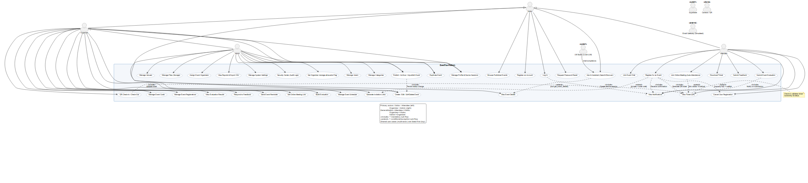

**Figure 3-1: EventFlow Core Use Case Diagram**

يُكمل الجدول 3-2 وصف المتطلبات، بينما يُفصّل الجدول 3-6 الربط بينها وبين الصفحات والخدمات والاختبارات. وفيما يلي أوصاف مختارة لأهم حالات الاستخدام بصيغة أكاديمية:

**حالة استخدام: التسجيل في فعالية**

- **Actor:** Attendee، مع مشاركة Visitor عند إنشاء الحساب.
- **Preconditions:** وجود فعالية منشورة وغير محذوفة، وعدم تجاوز موعد إغلاق التسجيل، ووجود حساب مصادَّق أو إمكانية إنشاء حساب.
- **Main Flow:** يفتح المشارك صفحة الفعالية → يتحقق النظام من الحالة والموعد والسعة → يُرسل طلب التسجيل → يُنشأ سجل `confirmed` وتُصدر تذكرة → يُرسل إشعار تأكيد.
- **Alternative Flow:** إذا اكتملت السعة C يُنشأ السجل بحالة `waitlisted`، ثم يُرقَّى تلقائياً عند تحرير مقعد عبر المشغّل `notify_waitlist_promotion`. أما الفعالية الخاصة فيُطلب رمز دعوة صالح قبل إتمام التسجيل.
- **Postconditions:** وجود تسجيل مرتبط بالمستخدم والفعالية، وتذكرة فريدة إذا كان التسجيل مؤكداً، وإشعار محفوظ في `notifications`.

**حالة استخدام: التحقق من الحضور**

- **Actor:** Organizer أو Admin.
- **Preconditions:** صلاحية الوصول إلى صفحة `AttendanceManagement`، وتذكرة `_qr` صالحة معروضة على جهاز الحاضر.
- **Main Flow:** فتح الماسح → قراءة الحمولة → فك ترميزها والتحقق من `v` و`code` و`eventId` و`registrationId` → البحث عن التذكرة → التحقق من حالة التسجيل → تسجيل `check_in` وتحويل التذكرة إلى `used`.
- **Alternative Flow:** تُرفض التذكرة المستخدمة أو غير الصالحة أو التابعة لفعالية أخرى برسالة سبب واضح. ويُدعم الإدخال اليدوي والحضور التلقائي للفعاليات الإلكترونية.
- **Postconditions:** سجل حضور واحد على الأقل، وتحديث حالة التذكرة، وعدم قبول نفس الرمز مرة ثانية.

**حالة استخدام: إنشاء فعالية**

- **Actor:** Organizer، وقد يكون Admin.
- **Preconditions:** دور `organizer` أو `admin`، ووجود فئة وموقع صالحين للفعاليات الحضورية.
- **Main Flow:** إدخال البيانات الأساسية → اختيار النوع والخصوصية → تحديد السعة والمواعيد → حفظ المسودة → النشر إلى `published`.
- **Alternative Flow:** يمكن حفظ الفعالية كمسودة، أو نسخها، أو أرشفتها، أو إلغاء نشرها، أو تعيين منظمين إضافيين.
- **Postconditions:** صف فعالية في `events`، وعلاقات في `event_organizers` عند تعيين منظمين، وظهور الفعالية في التصفح العام إذا كانت `public` و`published`.

**حالة استخدام: إرسال تقييم**

- **Actor:** Attendee.
- **Preconditions:** تسجيل `confirmed` وحضور مسجل، ووجود استبيان مرتبط بالفعالية.
- **Main Flow:** فتح نموذج التقييم → الإجابة على الأسئلة → استدعاء RPC `submit_evaluation` → حفظ الإرسال والإجابات → تحديث الإحصاء.
- **Alternative Flow:** يُرفض الإرسال المكرر أو إرسال من غير الحاضرين أو من تسجيل غير مؤكد.
- **Postconditions:** صف واحد في `evaluation_submissions` لكل مشارك لكل استبيان، وإجابات مرتبطة بالأسئلة.

**حالة استخدام: إدارة المستخدمين**

- **Actor:** Admin.
- **Preconditions:** دور `admin` وجلسة صالحة.
- **Main Flow:** عرض قائمة المستخدمين → فتح تفاصيل مستخدم → إيقاف أو تفعيل الحساب → تسجيل العملية في `audit_logs`.
- **Alternative Flow:** رفض الوصول إذا كان المستخدم الحالي غير `admin`، أو عرض رسالة خطأ عند فشل الاستدعاء.
- **Postconditions:** تحديث حالة `suspended`، وإبطال جلسات المستخدم عند الإيقاف، ووجود سجل تدقيق.

**حالة استخدام: سؤال المساعد الذكي**

- **Actor:** Visitor أو أي مستخدم مصادَّق.
- **Preconditions:** توفر خادم LM Studio محلي في المسار الفعلي، وإمكانية الوصول إلى واجهة البيانات.
- **Main Flow:** إدخال سؤال → تحديد الحاجة إلى أداة بيانات → استدعاء إحدى الأدوات الست → إعادة النتائج → صياغة إجابة داخل واجهة المحادثة.
- **Alternative Flow:** إذا تعذّر الاتصال بخادم النموذج تظهر رسالة خطأ، ويُرفض السؤال خارج نطاق الفعاليات والمواقع والفئات.
- **Postconditions:** إجابة مستندة إلى بيانات قاعدة البيانات أو رسالة رفض أو خطأ واضحة.

### 3.6 نمذجة البيانات ومخطط ERD

يُميَّز في قاعدة البيانات بين الكيانات الأساسية التي تمثل دورة حياة الفعالية والكيانات المساندة التي تدعم الإدارة والأمان. ويُظهر مخطط ERD المأخوذ من `uml-exhaustive/final/03_erd.mmd` ثلاثين جدولاً، وكل علاقة فيه مقابلة لقيد Foreign Key فعلي في `supabase/schema.sql`. ويُلخَّص في الجدول 3-4.

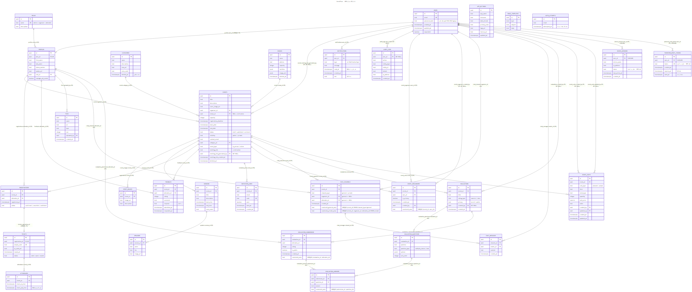

**Table 3-4: Main EventFlow Data Entities**

| Entity | Purpose |
| --- | --- |
| `users` / `roles` / `profiles` | الحسابات والأدوار والملفات الشخصية وصلاحية إدارة كل الفعاليات |
| `categories` / `venues` | تصنيف الفعاليات وأماكن الانعقاد والسعة والمرافق |
| `events` / `event_images` / `event_organizers` | بيانات الفعالية وصورها والعلاقة متعددة المنظمين |
| `sessions` / `speakers` | البرنامج الزمني والجلسات والمتحدثون |
| `registrations` | طلبات المشاركة وحالاتها وربطها بالمستخدم والفعالية |
| `tickets` | التذاكر الفريدة وحالتها وارتباطها بالتسجيل |
| `attendance` | تسجيل الدخول والخروج ومصدر الحضور |
| `invitation_links` | دعوات الفعاليات الخاصة ورموزها واستهلاكها |
| `evaluations` / `evaluation_questions` / `evaluation_submissions` / `evaluation_answers` | الاستبيانات وإجابات المشاركين |
| `event_costs` / `finance` | التكاليف المخططة والفعلية والمصادر المالية |
| `notifications` / `chat_channels` / `chat_messages` | الإشعارات والمحادثات العامة والخاصة |
| `audit_logs` / `device_sessions` / `auth_attempts` / `password_reset_tokens` | التدقيق وجلسات الأجهزة وحدود المحاولات ورموز الاستعادة |

### 3.7 مخططات التسلسل

تُظهر مخططات التسلسل الستة ترتيب الرسائل بين الفاعل والواجهة والخدمات وقاعدة البيانات، مع إبراز مسارات النجاح والفشل. مصدر هذه المخططات هو `uml-exhaustive/04a_sequence_auth.mmd` حتى `04f_sequence_chatbot.mmd`.

**المصادقة:** يرسل المستخدم بيانات الدخول إلى `authService`، الذي يستدعي RPC `authenticate_user` بعد فحص `RateLimiter`. عند نجاح التحقق تُنشأ جلسة جهاز ويُحفظ الرمز محلياً، بينما يُسجَّل فشل المحاولة في `auth_attempts`. وإذا عاد RPC بالخطأ `PGRST202` يُستخدم المسار القديم للتحقق من تجزئة SHA-256.

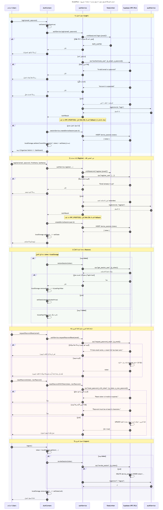

**التسجيل:** يرسل المشارك طلب التسجيل إلى `eventService`، الذي يتحقق من السعة والموعد والخصوصية قبل الإدراج. عند اكتمال السعة يُدرج السجل بحالة `waitlisted`، وعند تحرير مقعد ينفذ المشغّل ترقية أول مسجل في الانتظار وينشئ إشعاراً.

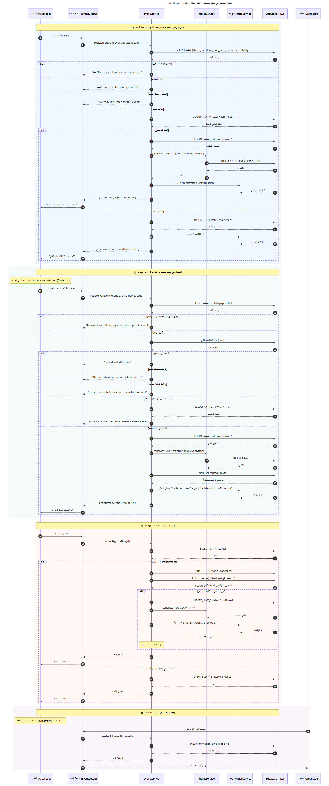

**فحص الحضور:** يقرأ `QrScanner` الحمولة، ويستدعي `attendanceService.findTicketByCode` ثم `checkIn`. ويُرفض الطلب إذا كانت التذكرة مستخدمة أو غير صالحة أو مرتبطة بتسجيل غير مؤكد، بينما يُسجَّل `check_out` لاحقاً.

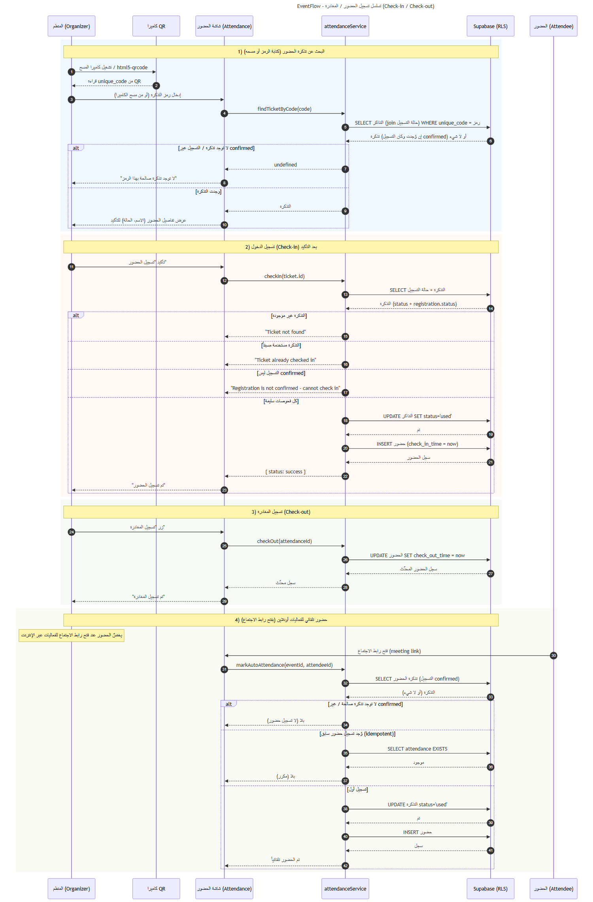

**المحادثة:** تضمن الخدمة وجود قناة عامة أو خاصة فريدة، ثم تُدرج الرسالة ويبثّ Supabase Realtime التحديث للأطراف المشتركة.

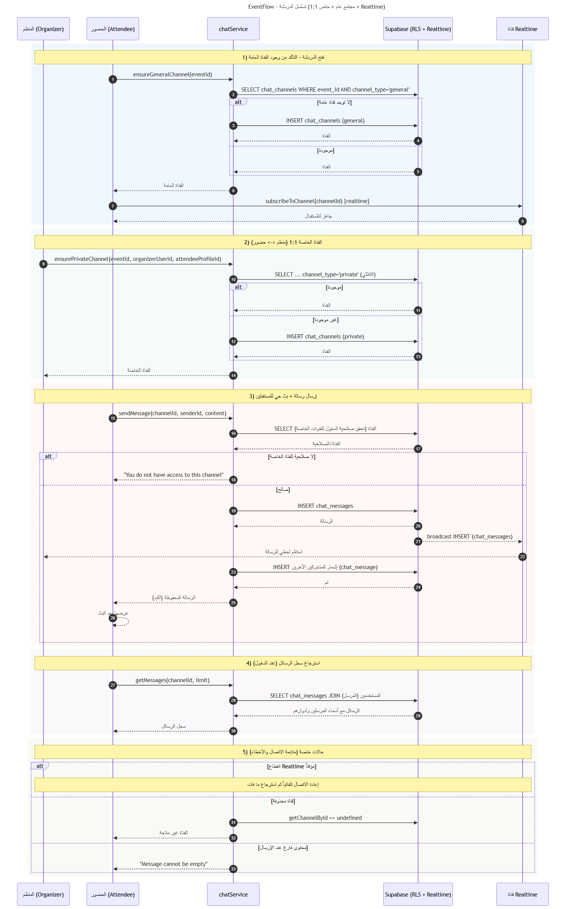

**التقييم:** ينشئ المنظم الاستبيان والأسئلة، ويتحقق النظام من `hasSubmitted` قبل استدعاء `submit_evaluation`، ويرفض الإرسال المكرر أو غير المؤكد على مستوى الخادم.

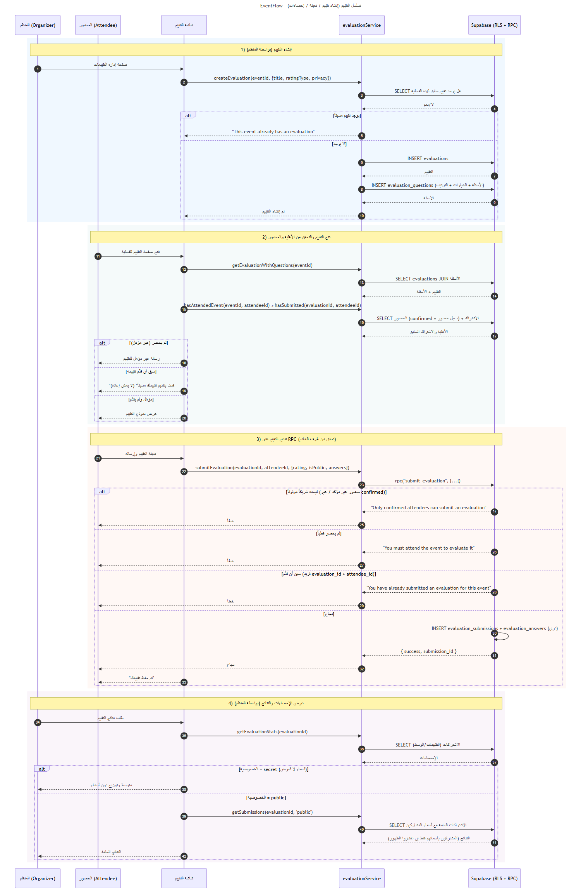

**المساعد الذكي:** يرسل المستخدم سؤالاً إلى `useChat`، الذي يتواصل مع LM Studio عبر `/lmstudio`، ثم ينفّذ الأدوات الست مباشرة عبر REST من المتصفح، وتُعاد النتائج إلى النموذج لصياغة الإجابة. وتُذكر دالة `supabase/functions/chatbot/index.ts` كمسار تصميمي بديل غير مستخدم من الواجهة الحالية.

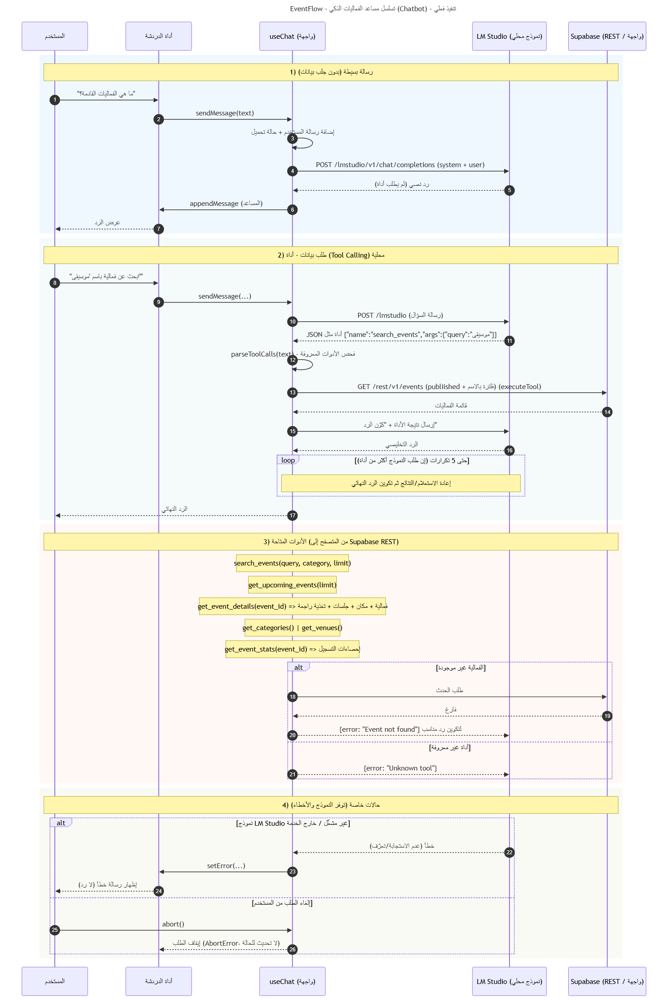

### 3.8 مخططات الأنشطة

يغطي مخطط النشاط الأول مسار التسجيل كاملاً: التحقق من النشر والموعد، والتمييز بين فعالية عامة وأخرى خاصة تتطلب رمز دعوة، والتحقق من تكرار التسجيل، ثم فحص السعة C، ثم إصدار التذكرة أو الإدراج في قائمة الانتظار، مع مسارات الفشل لكل شرط. ومصدره `uml-exhaustive/final/05a_activity_registration.mmd`.

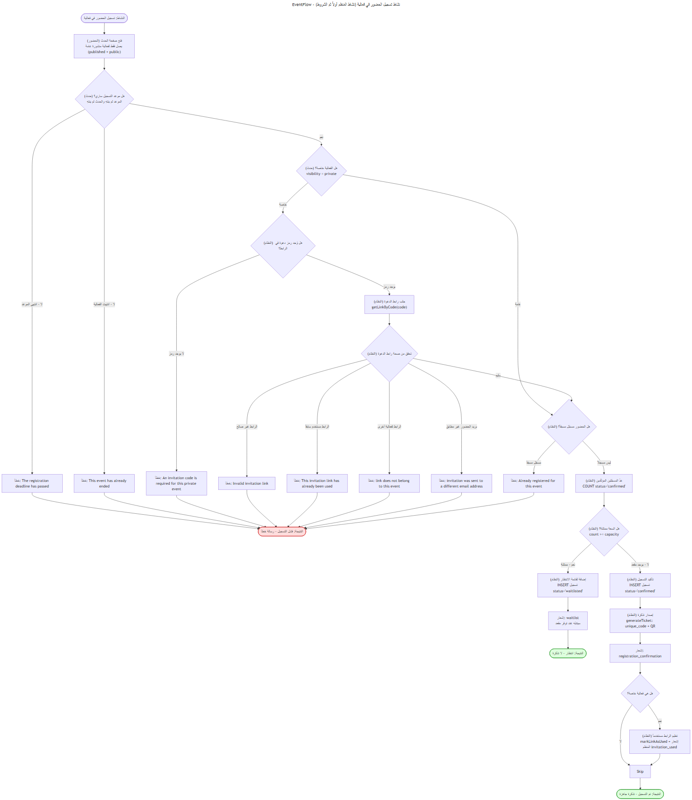

ويغطي المخطط الثاني مسار الدخول عبر الكاميرا أو الإدخال اليدوي، وأعطال التذكرة الثلاثة، وتسجيل الانصراف، والحضور التلقائي للفعاليات الإلكترونية. ومصدره `uml-exhaustive/final/05b_activity_checkin.mmd`.

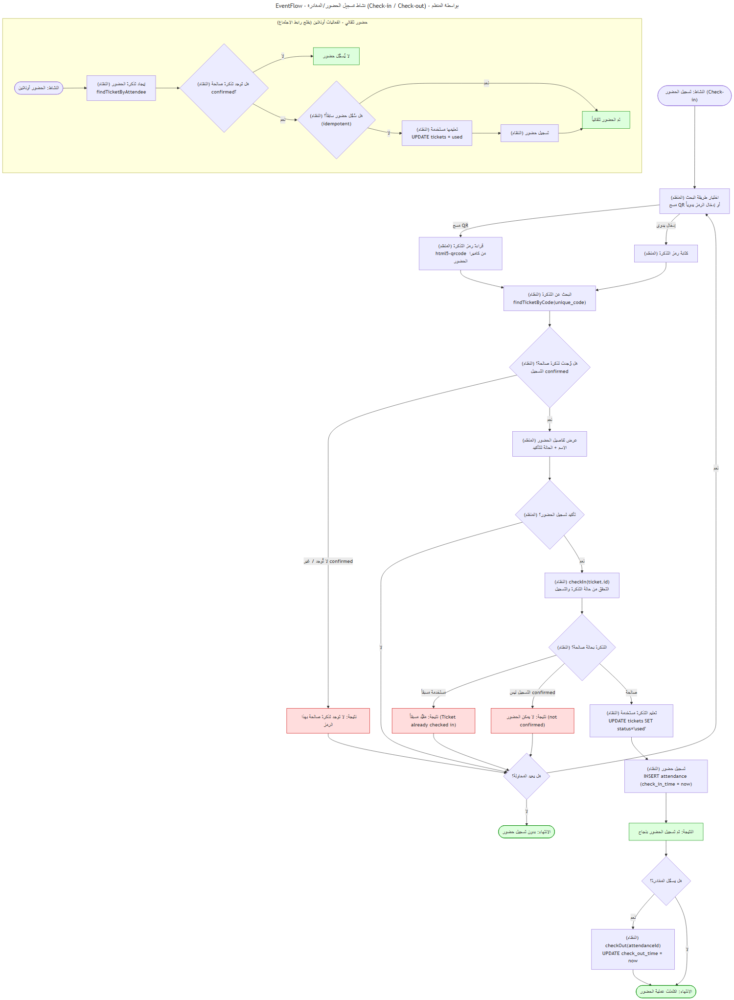

### 3.9 مخططات الحالات

يُوحّد `uml-exhaustive/final/07_state_machine.mmd` آلات حالات التسجيل والتذكرة والحضور والفعالية والجلسة والتقييم والدعوة. ويُبيّن الجدول 3-5 الحالات الأساسية وانتقالاتها كما هي مطبقة في الشيفرة والمخطط القاعدي.

**Table 3-5: Main Event, Registration and Ticket States**

| Entity | States | Transitions to document |
| --- | --- | --- |
| `events` | `draft`، `published`، `archived` | `draft → published` عند النشر، `published → draft` عند إلغاء النشر، `published → archived` عند الأرشفة |
| `registrations` | `confirmed`، `waitlisted`، `cancelled` | `waitlisted → confirmed` عند الترقية، `confirmed → cancelled` عند الإلغاء |
| `tickets` | `valid`، `used`، `invalid` | `valid → used` عند الفحص الناجح أو الحضور التلقائي، `valid → invalid` عند الإبطال |
| `attendance` | لا حضور، `checked_in`، `checked_out` | الإدراج عند الدخول، ثم تحديث وقت الانصراف |
| `event_requests` | `pending`، `reviewing`، `approved`، `rejected`، `needs_info` | انتقالات المراجعة حسب قرار المسؤول |

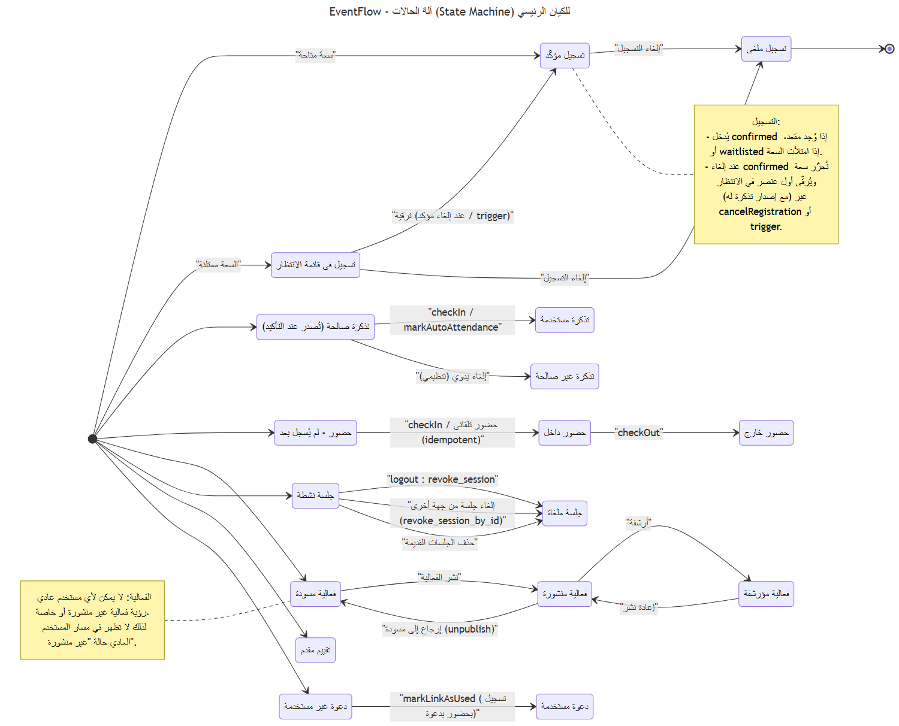

تُظهر آلة الحالات قيدين مهمين: لا تنتهي صلاحية جلسة الجهاز صراحةً في التنفيذ الحالي، إذ يُحدَّث `last_active_at` عند استدعاء `get_session_user` فقط؛ ولا تُخزَّن حالة `pending` للتسجيل في المخطط القاعدي رغم ورودها في الثوابت. ويُسجَّل هذان الأمران ضمن القيود في الفصل السادس.

### 3.10 مصفوفة تتبع المتطلبات

يربط الجدول 3-6 بين مجموعات المتطلبات والصفحات وال services والجداول والاختبارات. وتُستخدم المعرّفات FR-01 إلى FR-11 كما وردت في قالب التوثيق المعتمد وجدول حالات الاختبار، لضمان اتساق الترقيم بين التحليل والتنفيذ والنتائج.

**Table 3-6: Requirements Traceability Summary**

| Requirement group | Primary pages | Primary services / database | Tests |
| --- | --- | --- | --- |
| FR-01 المصادقة | `Login`، `Register`، `ForgotPassword`، `ResetPassword`، `RestoreAccount` | `authService`، `passwordResetService`، `auth_attempts` | `authService.test.ts`، TC-01 إلى TC-05 |
| FR-02 إدارة الفعاليات | `Events`، `EventForm`، `EventManagement`، `EventMeeting` | `eventService`، `events`، `event_organizers` | `eventService.test.ts`، TC-06 إلى TC-08 |
| FR-03 التسجيل وقائمة الانتظار | `RegistrationManagement`، `InvitationManagement` | `registrationService`، `invitationService`، `notify_waitlist_promotion` | TC-09 إلى TC-11 |
| FR-04 التذاكر وفحص الحضور | `TicketDetail`، `AttendanceManagement` | `ticketCode`، `ticketService`، `attendanceService` | `ticketCode.test.ts`، TC-12 إلى TC-14 |
| FR-05 الجلسات والمتحدثون | `ScheduleManagement` | `sessionService`، `sessions`، `speakers` | TC-15 |
| FR-06 التقييمات والتغذية الراجعة | `EventEvaluation`، `EvaluationManagement`، `FeedbackManagement` | `evaluationService`، `feedbackService`، `submit_evaluation` | TC-16، TC-17 |
| FR-07 المحادثات والإشعارات | `EventChat`، `Notifications`، `Broadcast` | `chatService`، `notificationService`، `chat_channels` | TC-18، TC-19 |
| FR-08 التقارير والتحليلات | `Dashboard`، `Reports` | `dashboardService`، `reportsService`، `exportService` | `dashboardService.test.ts`، TC-20، TC-21 |
| FR-09 الشؤون المالية والحملات | `EventCosts`، `Finance`، `Campaigns`، `Audience` | `costService`، `financeService`، `campaignService` | TC-22 |
| FR-10 الإدارة والأمان | `UserManagement`، `SecurityCenter`، `Bans`، `SystemSettings` | `userService`، `auditService`، `RLS`، `rateLimit` | TC-23، TC-24 |
| FR-11 التعريب وإمكانية الوصول | `src/i18n/*`، `src/contexts/*` | `LanguageContext`، `ThemeContext`، `formatters` | `i18n.test.ts`، `formatters.test.ts`، `messageLocalizer.test.ts`، TC-25 |

تُكمل الاختبارات الآلية الموجودة في المستودع هذه المصفوفة، منها اختبارات `eventDates.test.ts` و`settingsService.test.ts`، إلى جانب اختبارات الخدمات المذكورة أعلاه. وتُسجَّل النتائج الفعلية لهذه الاختبارات في الفصل الخامس والملحق D دون ادعاء نتائج لم تُرصد.

**ملخص الفصل:** حلّل هذا الفصل المتطلبات الوظيفية في أحد عشر باباً، وربط كل متطلب بمعرّف وفاعل وسلوك متوقع ودليل تنفيذي، وحدد المتطلبات غير الوظيفية وأدلتها. ثم قدّم نمذجة حالات الاستخدام والبيانات والسلوك الديناميكي عبر مخططات مستخرجة من المستودع، وختم بمصفوفة تتبع تربط المتطلبات بالصفحات والخدمات والاختبارات، بما يهيئ الأساس لتصميم النظام في الفصل التالي.

---

## الفصل الرابع: تصميم المشروع

**Chapter 4**

**Project Design**

*Graduation Project Report*

---

### 4.1 مقدمة

يحوّل هذا الفصل نتائج التحليل إلى تصميم تقني قابل للتنفيذ. يعتمد التصميم على فصل واضح بين واجهة المستخدم وطبقة الخدمات وطبقة البيانات، مع توثيق المخططات الفعلية الموجودة في مجلد `uml-exhaustive/final/`. لا يُقدَّم أي مكوّن لم يظهر في الشيفرة أو في مخطط قاعدة البيانات؛ فالمعمارية والتدفقات المعروضة مستخرجة من الملفات `06_architecture.mmd` و`08_component.mmd` و`09_deployment.mmd` و`03_erd.mmd`، ومطابقة لما هو منفذ في `src/` و`supabase/`.

### 4.2 معمارية النظام

تتكون المعمارية من أربع طبقات مترابطة:

1. **طبقة العرض (Pages / Components):** صفحات React المسؤولة عن التصفح العام ولوحات الأدوار، مع مكوّنات واجهة مشتركة من Radix UI ومكوّنات محادثة وماسح رمز QR.
2. **طبقة السياقات والحراس (Contexts / Guards):** `AuthContext` و`LanguageContext` و`ThemeContext` و`SettingsContext`، إضافة إلى `ProtectedRoute` و`PublicRoute` اللذين يفرضان قواعد الوصول حسب الدور قبل عرض الصفحة.
3. **طبقة الخدمات (Services):** وحدات TypeScript تغلّف استدعاءات Supabase وتحوّل الصفحات والاستجابات إلى نماذج يستهلكها العرض، وتشمل `authService` و`eventService` و`registrationService` و`ticketService` و`attendanceService` وغيرها.
4. **طبقة الخلفية (Supabase / PostgreSQL):** جداول علائقية ودوال `SECURITY DEFINER` ومشغلات وسياسات `RLS` وRealtime وStorage، مع دالة Edge بديلة للمحادثة.

يُظهر الشكل 4-1 المعمارية كما هي موثقة في المستودع، بما في ذلك المسار الفعلي للمساعد الذكي عبر `/lmstudio` والمسار البديل عبر دالة Edge.

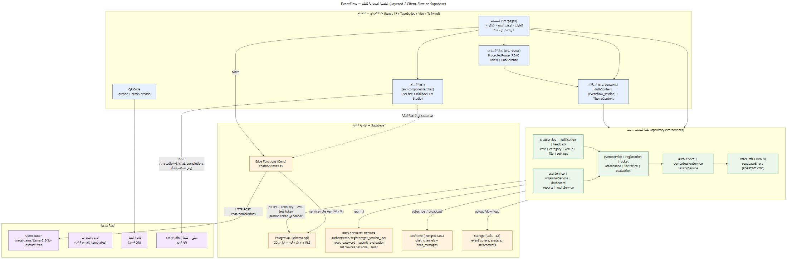

**Figure 4-1: EventFlow System Architecture**

يكمل مخطط المكوّنات تحديد التفاعل بين الصفحات والخدمات، ويُظهر مخطط النشر انتقال الحزمة الثابتة إلى مستضيف ويب مع بقاء قاعدة البيانات والخدمات في Supabase.

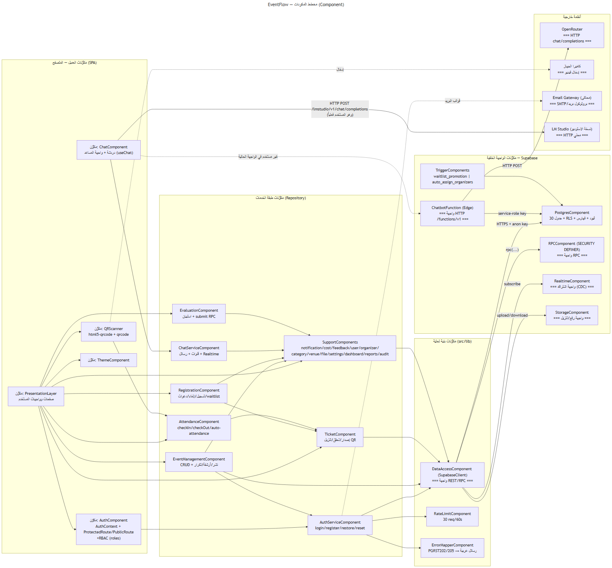

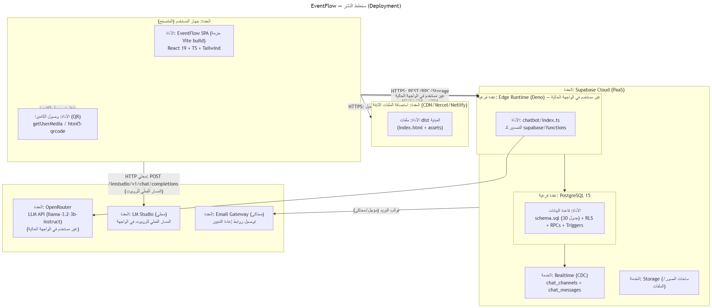

### 4.3 تصميم قاعدة البيانات

صُممت قاعدة البيانات كنموذج علائقي مركزي يربط دورة حياة الفعالية ببعضها. يعتمد التصميم على مفاتيح أساسية من نوع `uuid`، ومفاتيح أجنبية صريحة، وقيود تفرد لمنع التكرار، وفهارس على المفاتيح الأجنبية والحقول المستخدمة في التصفية. وتُراعى التطبيع حتى الدرجة الثالثة في الجداول الأساسية، مع تكرار مقصود ومضبوط لبعض الحقول في سجلات التدقيق والإشعارات لأغراض العرض والتتبع.


يُظهر مخطط ERD الكيانات الأساسية والعلاقات بينها، ومن أهمها: علاقة `events` بـ `categories` و`venues` و`profiles`، وعلاقة `registrations` بكل من `events` و`profiles`، وارتباط `tickets` و`attendance` بالتسجيل، وارتباط `sessions` بالفعالية وارتباطها بعلاقة واحد إلى متعدد مع `speakers`، وعلاقات `evaluations` و`chat_channels` و`event_costs` بالفعالية. كما تظهر كيانات الأمان `audit_logs` و`device_sessions` و`auth_attempts` و`password_reset_tokens`.

يُعد الفرق بين `events.organizer_id` و`event_organizers.user_id` نقطة تصميم مهمة: الأول يشير إلى `profiles.id`، بينما الثاني يشير إلى `users.id`، ولذلك يُوثَّق هذا الاختلاف في الملحق B لتجنب الخلط عند إضافة استعلامات أو سياسات جديدة.

**Table 4-1: Core Database Tables**

| Table | Main purpose |
| --- | --- |
| users | هوية المصادقة والبريد وتجزئة كلمة المرور وحالة الحساب |
| profiles | البيانات الشخصية وإسناد الدور وصلاحيات تنظيم الفعاليات |
| roles | أسماء الأدوار وأوصافها |
| events | بيانات الفعالية وحالتها وظهورها ونوعها وموقعها ومنظمها |
| categories / venues | تصنيف الفعاليات والمواقع الفعلية |
| registrations | حالة التسجيل والسعة وحالة قائمة الانتظار |
| tickets | هوية التذكرة ورمزها وحالة التحقق منها |
| attendance | سجلات الدخول والخروج ومصدر الحضور |
| sessions / speakers | برنامج الفعالية ومعلومات المتحدثين |
| evaluations / evaluation_questions / evaluation_submissions | نماذج التقييم وإجابات المشاركين |
| notifications | إشعارات المستخدمين وحالة قراءتها |
| chat_channels / chat_messages | المحادثات العامة والخاصة للفعالية |
| event_costs / expenses / funding_sources | ميزانية الفعالية والتكاليف الفعلية ومصادر التمويل |
| email_campaigns / email_campaign_recipients | تعريفات الحملات البريدية والمستلمون |
| user_bans / event_requests / audit_logs | الإشراف وسير الموافقة وتتبع العمليات الأمنية |
| app_settings / files | إعدادات النظام والملفات المرفوعة |

### 4.4 تصميم الواجهة الخلفية

تُنفَّذ الوظائف الخلفية عبر ثلاث آليات مترابطة:

- **الدوال المخزنة والإجراءات عن بُعد (RPC):** دوال مثل `authenticate_user` و`register_user` و`get_session_user` و`request_password_reset` و`reset_password_with_token` و`submit_evaluation` و`notify_waitlist_promotion` و`list_user_sessions`. تعمل هذه الدوال بصلاحيات `SECURITY DEFINER` مع تحقق داخلي من المدخلات، بحيث لا تعتمد على الأذونات الممنوحة للعميل.
- **المشغلات (Triggers):** يوجد مشغلان في `supabase/schema.sql`: `trigger_waitlist_promotion` بعد تحديث `registrations` لترقية أول مسجل في قائمة الانتظار، و`trigger_auto_assign_organizers` بعد إدخال `events` لتعيين المنظمين الذين يملكون `manages_all_events`. أما حماية الأعمدة الحساسة فتُنفَّذ بصلاحيات صريحة وسياسات وليس بمشغلات إضافية.
- **Realtime والبث:** يستخدم Supabase Realtime لجداول `chat_channels` و`chat_messages` و`meeting_chat_messages`، فتصل الرسالة الجديدة إلى المشاركين دون إعادة تحميل الصفحة. وتُستخدم الإشعارات الداخلية أو الرسائل الإدارية العامة لإبلاغ المستخدمين خارج نطاق المحادثة.

يوجد أيضاً ملف `supabase/functions/chatbot/index.ts` الذي يمثل تصميماً بديلاً للمساعد الذكي. أما المسار الفعلي المستخدم من الواجهة فهو `useChat` في المتصفح، والذي يتواصل مع LM Studio عبر وكيل `/lmstudio` وينفّذ أدوات البيانات الست مباشرة عبر REST. يُذكر هذا التمييز صراحةً حتى لا يُفهم وجود الدالة البديلة على أنها المسار المُشغَّل.

### 4.5 تصميم الواجهة الأمامية

تعتمد الواجهة على تطبيق صفحة واحدة يبدأ من `src/App.tsx`، حيث تُثبَّت السياقات العامة ثم يُحمّل جدول المسارات من `src/routes/index.tsx`. تُحمّل الصفحات عند الطلب عبر دوال تحميل كسولة، مما يقلل حجم الحزمة الأولية. وتُقسَّم المسارات إلى:

- مسار عام يشمل الصفحة الرئيسية وقائمة الفعاليات وتفاصيل الفعالية والمصادقة.
- مسار لوحة تحكم محمي بـ `ProtectedRoute`، وتنقسم داخلياً حسب الأدوار إلى مسارات المشارك والمنظم والمسؤول.
- مسارات خاصة بإجراءات حساسة مثل إعادة تعيين كلمة المرور واستعادة الحساب، وتُعامل كمسارات عامة مع قيود زمنية أو رمزية.

تُركّز خدمات الواجهة على تحويل استجابات Supabase إلى أخطاء مفهومة عبر `supabaseErrors.ts`، وتُعرض الرسائل باستخدام `sonner`. وتدعم الواجهة العربية والإنجليزية عبر `src/i18n/` مع اتجاه RTL عند اختيار العربية، وتتيح `ThemeContext` التبديل بين الثيمات. وتُستخدم مكوّنات Radix لتأمين سلوكيات الوصول مثل النوافذ الحوارية وقوائم الاختيار وعلامات التبويب.

### 4.6 تصميم الأمان

يُصاغ نموذج التهديد حول أربعة أصول: بيانات الهوية، بيانات الفعاليات والتذاكر، الرسائل والإشعارات، وسجلات التدقيق. ويشمل الفاعلون مستخدماً عادياً ومنظماً ومسؤولاً وطرفاً خارجياً يحاول تجاوز الصلاحيات. أهم التهديدات وإجراءات التخفيف:

- **انتحال الهوية أو تخمين كلمة المرور:** تُخفَّظ كلمات المرور بـ bcrypt، وتُسجَّل المحاولات الفاشلة في `auth_attempts`، ويُطبَّق حد خمس محاولات خلال خمس عشرة دقيقة، مع تحديد إضافي في `rateLimit.ts`.
- **تجاوز الصلاحيات عبر الواجهة أو العميل:** تفرض سياسات `RLS` حدود الوصول على مستوى الصف، وتُقيّد الأعمدة الحساسة بصلاحيات صريحة، بينما تُكمّل حراس المسارات ذلك على مستوى العرض.
- **إعادة استخدام التذكرة أو تعديل حمولة QR:** يتحقق `attendanceService` من الرمز ومعرّف الفعالية ومعرّف التسجيل، وتُحوَّل التذكرة إلى `used` بعد أول فحص ناجح.
- **الوصول غير المصرح به إلى ملفات أو سجلات:** تُضبط سياسات Storage في الهجرات، وتُسجَّل العمليات الإدارية في `audit_logs` لمراجعتها من مركز الأمان.
- **انكشاف بيانات الاعتماد أو المفاتيح:** لا توجد مفاتيح خاصة أو بيانات اعتماد إنتاجية حساسة داخل المستودع؛ ويُعتمد على متغيرات البيئة، مع وجود قيمة احتياطية قابلة للنشر في `src/lib/supabase.ts`. وتُذكر الحسابات التجريبية في الملحق E كبيانات عرض محلية فقط.

تبقى المخاطر المتبقية موثقة في `docs/SECURITY_ADVISORIES.md`، ومنها أن بعض دوال `SECURITY DEFINER` تحتاج مراجعة دورية، وأن جلسات الأجهزة لا تنتهي صراحةً في التنفيذ الحالي بل يُحدَّث وقت آخر نشاط لها.

### 4.7 تصميم واجهة المستخدم وتجربتها

تُصمَّم الواجهة لتقليل عدد الخطوات اللازمة لإتمام المهام المتكررة: البحث عن فعالية، التسجيل، عرض التذكرة، فحص الحضور، وتقديم التقييم. تعتمد الصفحات على حالات تحميل وحالات فارغة ورسائل خطأ واضحة، وتستجيب لتغيير حجم الشاشة. وتُوحَّد المصطلحات العربية في `src/i18n/ar.ts`، وتُنسَّق التواريخ والأرقام والعملات عبر `formatters.ts` بحسب اللغة الحالية.

لا تتضمن حزمة التوثيق لقطات شاشة حقيقية من التطبيق، ولذلك لا يُعرض أي ادعاء بصري غير مدعوم. ويُستخدم النص التالي في المواضع التي تتطلب دليلاً بصرياً: `[بحاجة إلى استكمال: توضيح البيانات المطلوبة هنا]`. ولا يُعد هذا النص نموذجاً أولياً أو لقطة من المنتج.

### 4.8 الخوارزميات ومنطق الأعمال

**خوارزمية التسجيل وقائمة الانتظار**

```text
INPUT eventId, attendeeId, C, deadline, visibility, inviteCode?
IF event.status != "published" OR event.deleted_at != null THEN reject("event unavailable")
IF now > deadline THEN reject("registration closed")
IF visibility == "private" AND inviteCode is invalid OR already used THEN reject("invalid invitation")
IF existing registration(eventId, attendeeId) THEN reject("duplicate registration")
R = count(confirmed registrations for event)
IF R < C THEN
  INSERT registration(status = "confirmed")
  INSERT ticket(unique_code) linked to registration
  INSERT notification(type = "registration_confirmation")
ELSE
  INSERT registration(status = "waitlisted")
END IF
OUTPUT registration, optional ticket, notification
```

**خوارزمية تحقق التذكرة**

```text
INPUT scannedPayload, expectedEventId, expectedRegistrationId
payload = decodeTicketCode(scannedPayload) OR scannedPayload as plain code
IF payload exists AND payload.v != 1 THEN reject("unsupported payload version")
IF payload.code != expected.code THEN reject("code_mismatch")
IF payload.eventId != expectedEventId THEN reject("event_mismatch")
IF payload.registrationId != expectedRegistrationId THEN reject("registration_mismatch")
ticket = findTicketByCode(code)
IF ticket.status != "valid" THEN reject("ticket not valid")
IF registration.status != "confirmed" THEN reject("registration not confirmed")
CALL check_in_ticket(ticket, expectedEventId, mode, source, sessionToken)
UPDATE ticket.status = "used"
OUTPUT attendance record
```

**خوارزمية ترقية قائمة الانتظار**

```text
INPUT eventId, cancelledRegistrationId
RELEASE seat for eventId
candidate = first waitlisted registration for eventId ORDER BY registered_at
IF candidate exists THEN
  UPDATE candidate.status = "confirmed"
  INSERT ticket linked to candidate
  INSERT notification(type = "waitlist_promotion")
END IF
OUTPUT promoted registration, optional ticket, notification
```

**خوارزمية تجميع التقييم**

```text
INPUT evaluationId, attendeeId, answers, rating
IF registration is not "confirmed" THEN reject("registration not confirmed")
IF attendance record is missing THEN reject("attendance required")
IF submission(evaluationId, attendeeId) exists THEN reject("duplicate submission")
CALL submit_evaluation(evaluationId, attendeeId, rating, isPublic, answers)
STORE evaluation_answers linked to the submission
AGGREGATE numeric ratings and text answers according to evaluation.privacy
OUTPUT submission and aggregate metrics
```

**خوارزمية التكاليف والتصدير**

```text
INPUT costItems OR filteredReportRows, exportFormat
VALIDATE quantity, unitPrice and currency
total = SUM(quantity * unitPrice) for the selected cost type
COMPARE planned total with actual total when both exist
BUILD rows with the report column order
EXPORT rows to XLSX, PDF or CSV using exportService
OUTPUT generated file or a localized error message
```

### 4.9 ملخص الفصل

قدم هذا الفصل التصميم المعماري والقاعدي والواجهة والخلفي والأمني استناداً إلى مخططات فعلية وشيفرة منفذة. وأظهر التصميم أن الفصل بين Pages وServices وSupabase يسهل تتبع كل متطلب، وأن قواعد الوصول موزعة بين حراس المسارات وسياسات قاعدة البيانات والدوال الآمنة. كما بيّن أن التذاكر وقوائم الانتظار والتقييمات تعتمد قواعد عمل صريحة وقابلة للتحقق، وأن المساعد الذكي له مسار فعلي مختلف عن دالة Edge البديلة. ينتقل الفصل التالي إلى بيئة التنفيذ ووحدات النظام واستراتيجية الاختبار والنتائج الفعلية.

---

## الفصل الخامس: التنفيذ والاختبار

**Chapter 5**

**Implementation and Test**

*Graduation Project Report*

---

### 5.1 مقدمة

يصف هذا الفصل كيف نُفّذ التصميم فعلياً، وما الوحدات الموجودة في المستودع، وكيف جرى اختبارها. تُؤخذ جميع الأرقام الواردة أدناه من ملفات المشروع أو من سجل تشغيل الاختبارات المحلي؛ فلا تُذكر نسبة تغطية أو زمن استجابة أو نتيجة اختبار لم تُرصد. كما يُفرَّق بين الاختبارات الآلية التي نُفذت فعلاً وبين سيناريوهات القبول الـ26 المدرجة في الملحق D والتي لم يُعثر على سجل تنفيذ منفصل لها.

### 5.2 بيئة التطوير والأدوات

**Table 5-1: Development and Testing Tools**

| Tool | Version / role |
| --- | --- |
| Node.js | بيئة تشغيل الإصدار 20+ لسلسلة أدوات Vite |
| npm | إدارة الحزم والسكربتات (`dev`, `build`, `lint`, `test`, `test:watch`, `preview`) |
| Vite | 8.1.1 خادم التطوير وبناء الإنتاج |
| TypeScript | ~6.0.2 فحص الأنواع الثابت؛ ويُشغَّل `tsc -b` قبل `build` |
| React / react-dom | 19.2.7 مكتبة المكوّنات وعارضها |
| Supabase JS | 2.110.2 عميل REST وRPC وRealtime وStorage |
| PostgreSQL | قاعدة بيانات علائقية مستضافة عبر Supabase |
| Vitest / Testing Library | 4.1.10 اختبارات آلية للوحدات والمكوّنات |
| Oxlint | 1.71.0 تحليل ثابت للشيفرة |

### 5.3 تنفيذ الوحدات الرئيسية

نُفّذت الوحدات وفق تقسيم الخدمات التالي:

- **المصادقة والحسابات:** `authService.ts` و`accountService.ts` و`passwordResetService.ts` و`deviceSessionService.ts`، مع صفحات `Login` و`Register` و`ForgotPassword` و`ResetPassword` و`RestoreAccount` و`ChangePassword` و`Profile`.
- **الفعاليات والتسجيل:** `eventService.ts` و`registrationService.ts` و`invitationService.ts`، مع صفحات `Events` و`EventDetail` و`EventForm` و`EventManagement` و`RegistrationManagement` و`InvitationManagement`.
- **التذاكر والحضور:** `ticketCode.ts` و`ticketService.ts` و`attendanceService.ts`، مع `QrScanner.tsx` و`TicketDetail.tsx` و`AttendanceManagement.tsx`.
- **الجلسات والتقييم والمحادثة:** `sessionService.ts` و`evaluationService.ts` و`feedbackService.ts` و`chatService.ts` و`notificationService.ts`، مع صفحات الإدارة والقنوات والإشعارات.
- **التقارير والمالية والحملات:** `dashboardService.ts` و`reportsService.ts` و`exportService.ts` و`costService.ts` و`financeService.ts` و`campaignService.ts`، مع صفحات `Dashboard` و`Reports` و`EventCosts` و`Finance` و`Campaigns` و`Audience`.
- **الإدارة والأمان:** `userService.ts` و`banService.ts` و`auditService.ts` و`settingsService.ts` و`rateLimit.ts`، مع `UserManagement` و`Bans` و`SecurityCenter` و`SystemSettings`.

يُظهر المقتطف التالي تحميل صفحات المسارات عند الطلب باسم المكوّن المطلوب، وهو ما يدعم تحسين حجم الحزمة الأولية دون تغيير واجهة الصفحة:

```tsx
// src/routes/index.tsx
/** Route-level code splitting: load a named page component only when needed. */
function namedLazy<T extends Record<string, ComponentType<any>>>(loader: () => Promise<T>, name: keyof T) {
  return lazy(() => loader().then((module) => ({ default: module[name] as ComponentType<any> })))
}
```

ويُظهر المقتطف التالي تنسيق حمولة التذكرة والتحقق من تطابقها مع بيانات التذكرة المتوقعة:

```ts
// src/services/ticketCode.ts
export const PAYLOAD_PREFIX = "EF1:"

export interface TicketPayload {
  v: 1
  code: string
  eventId?: string
  registrationId?: string
  mode?: AttendanceMode
}

export function encodeTicketCode(payload: TicketPayload): string {
  return `${PAYLOAD_PREFIX}${toBase64Url(JSON.stringify(payload))}`
}

export function verifyTicketPayload(
  payload: TicketPayload | undefined,
  expected: TicketIdentity,
): PayloadVerificationError | null {
  if (!payload) return null
  if (payload.code && expected.code && payload.code !== expected.code) return "code_mismatch"
  if (payload.registrationId && expected.registrationId && payload.registrationId !== expected.registrationId) {
    return "registration_mismatch"
  }
  if (payload.eventId && expected.eventId && payload.eventId !== expected.eventId) return "event_mismatch"
  return null
}
```

ويُظهر المقتطف التالي المسار الفعلي للمساعد الذكي: نقطة LM Studio عبر وكيل التطوير، والأدوات الست المسموح بها، وحلقة تنفيذ الأدوات حتى خمس مرات:

```ts
// src/components/chat/useChat.ts
const LM_STUDIO_URL = "/lmstudio/v1/chat/completions"

// AVAILABLE TOOLS:
// - get_upcoming_events(limit?: string)
// - get_categories()
// - get_venues()
// - search_events(query?: string, category?: string, limit?: string)
// - get_event_details(event_id: string)
// - get_event_stats(event_id: string)

const ALLOWED_TOOLS = new Set([
  "get_upcoming_events", "get_categories", "get_venues",
  "search_events", "get_event_details", "get_event_stats",
])

switch (name) {
  case "search_events": /* REST query on events */
  case "get_event_details": /* REST query by event id */
  case "get_categories": /* REST query on categories */
  case "get_venues": /* REST query on venues */
  case "get_upcoming_events": /* REST query filtered by date */
  case "get_event_stats": /* REST query for registration statistics */
  default: throw new Error(`Unknown tool: ${name}`)
}

for (let iteration = 0; iteration < 5; iteration += 1) {
  const toolCalls = parseToolCalls(reply)
  if (toolCalls.length === 0) return reply
  for (const call of toolCalls) {
    const result = await executeTool(call.name, call.args)
    messages.push({ role: "user", content: JSON.stringify(result) })
  }
}
```

أما حماية المسارات فتُنفَّذ قبل عرض الصفحة كما يظهر في المقتطف التالي:

```tsx
// src/routes/ProtectedRoute.tsx
export function ProtectedRoute({ children, roles }: ProtectedRouteProps) {
  const { isAuthenticated, isLoading, role } = useAuth()

  if (isLoading) return /* loading state */
  if (!isAuthenticated) return <Navigate to="/login" replace />
  if (roles && (!role || !roles.includes(role))) return <Navigate to="/dashboard" replace />
  return <>{children}</>
}
```

نظراً لعدم وجود لقطات شاشة موثقة في المستودع، يُذكر في هذا الموضع: `[بحاجة إلى استكمال: توضيح البيانات المطلوبة هنا]`، ولا يُستخدم أي رسم أو إطار بديل لإثبات سلوك الواجهة.

### 5.4 تنفيذ قاعدة البيانات

نُفّذ مخطط قاعدة البيانات وفق الترتيب التالي: `supabase/schema.sql` للجداول والقيود والدوال والمشغلات الأساسية، ثم `supabase/schema-part2-security.sql` للصلاحيات وسياسات `RLS`، ثم ثلاث عشرة هجرة في مجلد `supabase/migrations/` مرتبة زمنياً، وأخيراً `supabase/seed_demo_accounts.sql` لبيانات العرض المحلية عند الحاجة. وتشمل الهجرات تصحيح سياسات الرفع، وتقوية الأمان، وضبط ترتيب تواريخ الفعاليات، وإصلاح حمولة QR، وإضافة صلاحيات الحظر والتمويل وطلبات الفعاليات والبث والجمهور، وصيانة الفهارس.

يوثّق الملحق H هذا الترتيب كاملاً مع وصف كل هجرة، دون الادعاء بتطبيقها على مشروع Supabase حيّ؛ فالتوثيق يصف ملفات المستودع فقط.

### 5.5 تنفيذ الأمان

تُطبَّق الضوابط الأمنية في أكثر من طبقة:

- تجزئة كلمات المرور عبر bcrypt داخل دوال `authenticate_user` و`register_user`، مع مسار توافق عند غياب الدالة وظهور الخطأ `PGRST202`.
- تحديد محاولات الدخول الفاشلة في `auth_attempts` و`rateLimit.ts`، ومنع كشف وجود البريد في طلبات الاستعادة.
- جلسات أجهزة فعلية عبر `device_sessions` ودوال `list_user_sessions` و`revoke_session` و`revoke_other_sessions`.
- سياسات `RLS` وصلاحيات أعمدة صريحة في `schema-part2-security.sql` والهجرات اللاحقة، مع حماية `password_hash` ورموز الاستعادة ورموز الجلسات.
- سجل تدقيق `audit_logs` وصفحة `SecurityCenter` لمراجعة العمليات الإدارية.
- سياسات Storage للملفات المرفوعة، وقيود على فحص التذاكر تمنع تعديل الحمولة أو فحص تذكرة تعود لفعالية أخرى.

### 5.6 استراتيجية الاختبار

اعتمد الاختبار على مستويين:

1. **اختبارات آلية بلغة Vitest:** تغطي خدمات المصادقة والفعاليات ولوحة المؤشرات والإعدادات وترميز التذاكر، ودوال التاريخ والتنسيق والتعريب، ومكوّنات الواجهة الأساسية وسياق اللغة.
2. **مراجعات سيناريوهات يدوية:** صيغت 26 حالة اختبار في القالب المعتمد لتغطية FR-01 إلى FR-11 والمتطلب NFR-01، لكن لا يوجد سجل تنفيذ منفصل لها ضمن المستودع، لذلك تُترك نتيجتها في الملحق D دون ادعاء النجاح.

### 5.7 حالات الاختبار والنتائج

نُفّذ الأمر `npm.cmd test` محلياً؛ إذ تعذّر تشغيل `npm test` مباشرة بسبب سياسة تنفيذ السكربتات في PowerShell على هذا الجهاز، فاستُخدم المشغّل `npm.cmd` الذي ينفّذ نفس السكربت `vitest run`. كانت النتيجة الفعلية: **12 ملف اختبار ناجحاً من 12، و95 حالة اختبار ناجحة من 95، دون فشل، بمدة 12.00 ثانية**، وفق إصدار Vitest 4.1.10.

يوضح الجدول 5-2 عشر حالات آلية تمثيلية من هذه المجموعة. المعرّف `UT` يعني اختبار وحدة آلي، وهو مستقل عن معرّفات `TC` الخاصة بسيناريوهات القبول في الملحق D.

**Table 5-2: Representative Test Cases**

| ID | Scenario | Expected result | Status |
| --- | --- | --- | --- |
| UT-01 | الدخول ببيانات صحيحة (`authService.test.ts`) | تُعاد بيانات المستخدم والملف والدور | نجح |
| UT-02 | الدخول ببريد غير صالح (`authService.test.ts`) | يُلقى خطأ | نجح |
| UT-03 | التسجيل ببريد مكرر (`authService.test.ts`) | يُرفض التسجيل المكرر | نجح |
| UT-04 | استعادة كلمة مرور برمز غير صالح (`authService.test.ts`) | يُرفض الرمز غير الصالح | نجح |
| UT-05 | استبعاد الفعاليات المحذوفة من التصفح العام (`eventService.test.ts`) | تُعاد الفعاليات المنشورة غير المحذوفة فقط | نجح |
| UT-06 | حمولة تذكرة تشير إلى فعالية أخرى (`ticketCode.test.ts`) | تُرفض الحمولة | نجح |
| UT-07 | حمولة تذكرة تشير إلى تسجيل آخر (`ticketCode.test.ts`) | تُرفض الحمولة | نجح |
| UT-08 | سبعة أيام متتالية مع أيام فارغة (`dashboardService.test.ts`) | تُعاد سبعة أيام بتوقيت محلي | نجح |
| UT-09 | اللغة الافتراضية العربية مع RTL (`LanguageContext.test.tsx`) | يُطبَّق الاتجاه العربي | نجح |
| UT-10 | الأرقام العربية في التنسيق (`formatters.test.ts`) | تُستخدم الأرقام العربية | نجح |

توزّعت الحالات الـ95 على 12 ملف اختبار، منها 16 حالة في `i18n.test.ts`، و15 في `messageLocalizer.test.ts`، و14 في `formatters.test.ts`، و11 في `authService.test.ts`، و10 في `ticketCode.test.ts`، و9 في `eventDates.test.ts`، و7 في `LanguageContext.test.tsx`، و4 في `Button.test.tsx`، و3 في `Loading.test.tsx`، وحالتان لكل من `dashboardService.test.ts` و`eventService.test.ts` و`settingsService.test.ts`. لا تُذكر أي نسبة تغطية لأنها لم تُقس.

### 5.8 النشر

يُنتج الأمر `npm run build` مجلد `dist` بعد فحص الأنواع، ويمكن نشره على أي مستضيف ملفات ثابتة مع توجيه SPA fallback إلى `index.html`. يعتمد التطبيق على متغيرات بيئة تبدأ بـ `VITE_`، وأهمها:

- `VITE_SUPABASE_URL` و`VITE_SUPABASE_ANON_KEY` للاتصال بمشروع Supabase؛ ويوصى باستخدام المفتاح القابل للنشر في رفعات Storage.
- `VITE_APP_NAME` و`VITE_APP_URL` للبيانات الوصفية والروابط.
- `VITE_EMAIL_PROVIDER` و`VITE_EMAIL_API_KEY` و`VITE_EMAIL_FROM` اختيارية للإرسال الحقيقي، وإلا تُحاكى الحملات محلياً.
- `VITE_ACCOUNT_DELETION_GRACE_DAYS` لتحديد نافذة استعادة الحساب، والقيمة الافتراضية 30 يوماً.

لا يحتوي المستودع على ملف `.env` حقيقي، ولم تُستخدم أي بيانات اعتماد فعلية في هذا التقرير.

### 5.9 ملخص الفصل

استعرض الفصل بيئة التطوير والوحدات المنفذة وترتيب تنفيذ قاعدة البيانات والضوابط الأمنية واستراتيجية الاختبار. وأظهرت النتائج الفعلية نجاح 12 ملف اختبار و95 حالة آلية، مع الإبقاء على سيناريوهات القبول الـ26 دون نتائج مفترضة. كما بيّن الفصل أن النشر يعتمد على حزمة ثابتة ومتغيرات بيئة موثقة في `.env.example`، وأن لا بيانات اعتماد حقيقية مضمّنة في المستودع.

---

## الفصل السادس: النتائج والمناقشة

**Chapter 6**

**Results and Discussions**

*Graduation Project Report*

---

### 6.1 مقدمة

يقيس هذا الفصل ما تحقق من أهداف المشروع ومتطلباته استناداً إلى أدلة مادية في المستودع وسجل الاختبارات المحلي، ويناقش قابلية الاستخدام والأمان والقيود المتبقية. لا يُقدَّم أي رقم أداء أو نسبة تغطية أو زمن استجابة لأن مثل هذه القياسات غير موجودة في المصادر المتاحة، ويُكتفى بشرح الآليات التي تدعم الأداء مثل التحميل الكسول والفهارس.

### 6.2 استعراض النظام بحسب الدور

يمكن عرض مسار الاستخدام بحسب الدور كما يلي: يبدأ الزائر من الصفحة الرئيسية أو `/events`، ويتصفح الفعاليات المنشورة غير المحذوفة، ثم يفتح تفاصيل الفعالية والجلسات، وينشئ حساباً إذا رغب بالتسجيل. يستخدم المشارك لوحة التحكم لعرض التذاكر والإشعارات والتقييمات والمحادثة، بينما يدير المنظم الفعاليات والجلسات والتسجيلات والحضور والتكاليف والتقارير، ويدير المسؤول المستخدمين والأدوار والفئات والمواقع والإعدادات ومركز الأمان.

لا تتضمن حزمة التوثيق لقطات شاشة حقيقية من التطبيق؛ ولذلك يُذكر في هذا الموضع: `[بحاجة إلى استكمال: توضيح البيانات المطلوبة هنا]`، ولا يُستخدم لإثبات أي سلوك واجهة.

### 6.3 تحقق أهداف المشروع

**Table 6-1: Project Objectives and Delivered Features**

| Objective | Delivered evidence | Status |
| --- | --- | --- |
| توحيد دورة حياة الفعالية | الفعاليات والتسجيلات والتذاكر والجلسات والتكاليف والتقييمات والتقارير | مُحقَّق |
| لوحات تحكم قائمة على الأدوار | تخطيطات وحراس للمشارك والمنظّم والمسؤول | مُحقَّق |
| أتمتة التسجيل وقوائم الانتظار | فحص السعة وترقية قائمة الانتظار والإشعارات | مُحقَّق |
| التذاكر وفحص الحضور برمز QR | توليد التذاكر وماسح QR وسجلات الحضور | مُحقَّق |
| الجلسات والمتحدثون والتكاليف | إدارة البرنامج وتتبع تكاليف الفعالية | مُحقَّق |
| التقارير والتصدير | إحصاءات لوحة التحكم والتقارير والتصدير إلى XLSX/PDF | مُحقَّق |
| الأمان والتدقيق | سياسات `RLS` والمسارات المحمية وسجلات التدقيق والحظر وحدّ المعدل | مُحقَّق |
| واجهة ثنائية اللغة ومتجاوبة | معاجم العربية والإنجليزية واتجاه RTL وتخطيطات متجاوبة | مُحقَّق |
| التحقق الآلي | 12 ملف اختبار Vitest و95 حالة اختبار ناجحة | مُتحقَّق منه محلياً |

### 6.4 النتائج مقابل المتطلبات

**Table 6-2: Requirement Coverage Summary**

| Requirement group | Coverage | Evidence |
| --- | --- | --- |
| المتطلبات الوظيفية (FR-01 إلى FR-11) | مُنفَّذ | الفصلان 3 و5؛ الصفحات والخدمات وقاعدة البيانات |
| الأمان | مُنفَّذ | سياسات `RLS` ودوال المصادقة وسجلات التدقيق وحدّ المعدل |
| قابلية الاستخدام | مُنفَّذ | واجهة متجاوبة ومكوّنات قابلة لإعادة الاستخدام والتعريب |
| الأداء | مُعالَج | مسارات محمّلة عند الطلب وفهارس واستعلامات فعّالة |
| الموثوقية | مُعالَج | معالج الأخطاء والاختبارات والعمليات المعاملاتية |
| سيناريوهات القبول TC-01 إلى TC-26 | لم تُنفَّذ كمجموعة مستقلة | خانات نتيجة بديلة في الملحق D |

تتوافق هذه المصفوفة مع مصفوفة التتبع في الجدول 3-6 ومع جدول الاختبارات في الفصل 5، مع تمييز واضح بين «مُنفَّذ» و«مُختبر آلياً» و«سيناريو قبول لم يُسجَّل تنفيذُه».

### 6.5 مناقشة الأداء وقابلية الاستخدام

تُحمّل صفحات المسارات عند الطلب عبر `namedLazy` في `src/routes/index.tsx`، ويُفصل التحقق من الأنواع في خطوة البناء قبل إنشاء الحزمة. وتوجد فهارس على المفاتيح الأجنبية والحقول الأكثر استخداماً، وقد أفاد مستشار الأمان بأن مشكلة المفاتيح الأجنبية غير المفهرسة انخفضت من 50 تنبيهاً إلى صفر، وأن الفهارس المكررة انخفضت من 8 إلى صفر. ومع ذلك، لا يوجد سجل اختبار حمل أو قياس زمن استجابة، ولذلك لا يُستنتج من ذلك أي رقم أداء.

على مستوى قابلية الاستخدام، توفر الواجهة اتجاه RTL ومصطلحات عربية موحدة وتنسيقاً للأرقام والتواريخ بحسب اللغة، إضافة إلى رسائل خطأ مفهومة وحالات تحميل وفارغة. وتُغطي الاختبارات الآلية سلوك اللغة والتنسيق والتبديل والسياق، منها 16 حالة في `i18n.test.ts` و15 في `messageLocalizer.test.ts` و14 في `formatters.test.ts` و7 في `LanguageContext.test.tsx`، وهو ما يدعم الجزء البرمجي من قابلية الاستخدام، لكنه لا يُغني عن اختبار مستخدمين فعليين لم يُجرَ ضمن هذا العمل.

### 6.6 مناقشة الأمان والموثوقية

يعتمد النظام على نموذج مصادقة مخصص بجلسات `device_sessions` بدلاً من Supabase Auth JWT، ولذلك تُفرض الصلاحيات داخل دوال `SECURITY DEFINER` التي تتحقق من رمز الجلسة، بينما تبقى بعض الأدوات قابلة للاستدعاء من `anon` و`authenticated` لأسباب معمارية موثقة في `docs/SECURITY_ADVISORIES.md`. وتشمل الضوابط المطبقة:

- تجزئة كلمات المرور، وحدود محاولات الدخول، وعدم كشف وجود البريد في طلبات الاستعادة.
- حماية الأعمدة الحساسة بصلاحيات صريحة، وسياسات `RLS` على الجداول، وسياسات Storage على مجلد الرفع.
- سجل تدقيق ومركز أمان، وإبطال جلسات الأجهزة عند تغيير كلمة المرور أو إيقاف المستخدم.
- تقليل تنبيهات مستشار الأمان: من 50 إلى صفر للمفاتيح الأجنبية غير المفهرسة، ومن 8 إلى صفر للفهارس المكررة، ومن 26 إلى صفر لمسارات البحث القابلة للتغيير، ومن 1 إلى صفر لجدول مفعل بلا سياسة.

المخاطر المتبقية المسجلة في ملف الأمان تشمل: 90 تنبيهاً معلوماتياً حول فهارس غير مستخدمة، و80 تنبيهاً حول سياسات متعددة متساهلة، و28 دالة `SECURITY DEFINER` قابلة للتنفيذ من `anon` و28 من `authenticated`، وأن الدوال `submit_feedback` و`submit_evaluation` و`auto_assign_all_events_organizers` ما زالت تقبل معرّفات من الطالب دون رمز جلسة. كما أن سياسات الرفع لا تستطيع تحديد المستخدم لأن التطبيق لا يستخدم `auth.uid()`، وأن جلسات الأجهزة لا تنتهي صراحةً بل يُحدَّث `last_active_at` فقط. تُذكر هذه النقاط كقيود موثقة وليست ادعاءً بأن النظام خالٍ من المخاطر.

### 6.7 القيود

1. لا يوجد دفع إلكتروني؛ تُسجَّل التكاليف والمصادر المالية كبيانات إدارية.
2. لا يوجد تطبيق جوال أصلي، وإن كانت الواجهة متجاوبة.
3. فحص التذاكر يحتاج اتصالاً بالخلفية للتحقق من الحالة، فلا يعمل دون اتصال.
4. المساعد الذكي في المسار الفعلي يحتاج LM Studio محلياً عبر `/lmstudio`؛ ودالة Edge بديلة غير مستخدمة من الواجهة.
5. لا توجد قياسات أداء إنتاجية أو اختبارات حمل أو نسبة تغطية موثقة.
6. سيناريوهات القبول الـ26 لم يُعثر على سجل تنفيذ مستقل لها، ولذلك تُترك نتائجها دون ادعاء.
7. بيانات الهوية الأكاديمية والشعار الجامعي ولقطات الشاشة غير متوفرة، وقد استُخدمت حقول فارغة أو نص بديل موسوم.
8. حالة `pending` معرّفة في ثوابت التسجيل لكنها ليست حالة مخزنة في مخطط قاعدة البيانات الأساسي.

### 6.8 المناقشة

بالمقارنة مع العمل اليدوي أو الجداول المنفصلة، يوفر EventFlow مصدر بيانات واحداً يربط التسجيل بالتذكرة بالحضور بالتقييم بالتقرير، ويقلل تكرار إدخال البيانات ويجعل الترقيات والإشعارات آلية. وبالمقارنة مع المنصات التجارية المذكورة في الفصل الثاني، لا يدّعي المشروع نطاق جمهور أو بنية تحتية تجارية مماثلة لأن أدلتها غير متاحة داخل المستودع، لكنه يوفر شيفرة مصدر قابلة للتخصيص، وواجهة عربية RTL، وربطاً صريحاً بين كل متطلب وأدلة التنفيذ والاختبار.

وتُظهر النتائج أن الأهداف المحورية تحققت على مستوى الشيفرة وقاعدة البيانات والاختبارات الآلية، مع بقاء فجوة التوثيق البصري واختبار المستخدمين وقياسات الأداء كنقاط تحتاج عملاً مستقبلياً. كما تُظهر مراجعة الأمان أن جزءاً كبيراً من التنبيهات عولج، لكن بعض المخاطر المرتبطة بالنموذج المخصص للجلسات لا تزال مقبولة وموثقة.

### 6.9 ملخص الفصل

خلص هذا الفصل إلى أن الأهداف التسعة للمشروع تحققت بأدلة من الصفحات والخدمات وقاعدة البيانات، وأن متطلبات FR-01 إلى FR-11 مُغطاة، وأن 95 حالة اختبار آلي نجحت فعلياً. وفي المقابل، لا توجد نتائج مسجلة لسيناريوهات القبول الـ26، ولا قياسات أداء أو لقطات شاشة موثقة، ولا يزال عدد من تنبيهات الأمان مقبولاً وفق ما هو موثق. هذه الحدود تُؤخذ في الاعتبار في الاستنتاجات والتوصيات.

---

## الفصل السابع: الخاتمة والتوصيات

**Chapter 7**

**Conclusions and Recommendations**

*Graduation Project Report*

---

### 7.1 الاستنتاجات

أثبت مشروع EventFlow إمكانية بناء منصة ويب متكاملة لإدارة دورة حياة الفعالية داخل بيئة جامعية باستخدام تقنيات مفتوحة وقابلة للتخصيص. فقد نُفّذت وحدات المصادقة وإدارة الفعاليات والتسجيل وقوائم الانتظار والتذاكر والحضور والجلسات والتقييمات والمحادثات والإشعارات والتقارير والمالية والإدارة، وارتبطت بمخطط قاعدة بيانات واحد وسياسات وصول موثقة.

وتُظهر الأدلة أن الأهداف التي حُددت في الفصل الأول تحققت على مستوى التنفيذ: بوابة تصفح عام، وحراس مسارات حسب الدور، وأتمتة ترقية قائمة الانتظار، وتذكرة برمز فريد وفحص آلي، وتقييمات ومحادثات وإشعارات، ولوحات تقارير وتصدير، وضوابط أمان وسجل تدقيق، وواجهة عربية مع RTL. كما نجح 12 ملف اختبار آلي يضم 95 حالة عند تشغيلها محلياً، دون فشل مسجل.

في الوقت نفسه، يبرز التقرير حدوداً واضحة: غياب الدفع الإلكتروني والتطبيق الأصلي والعمل دون اتصال، وعدم توفر قياسات أداء أو لقطات شاشة موثقة، وعدم تنفيذ سيناريوهات القبول الـ26 كسلسلة اختبارات مستقلة، وبقاء بعض تنبيهات الأمان المقبولة المرتبطة بنموذج الجلسات المخصص. إن ذكر هذه الحدود لا يقلل من الإنجاز، بل يجعل التقييم أكاديمياً قابلاً للتحقق.

### 7.2 التوصيات والأعمال المستقبلية

**تحسينات قصيرة المدى**

1. تنفيذ سيناريوهات القبول الـ26 وتسجيل نتائجها الفعلية وتاريخ كل تنفيذ واسم البيئة، ثم ربطها بالاختبارات الآلية حيثما أمكن.
2. التقاط لقطات شاشة حقيقية من التطبيق لكل دور، واستبدال النص البديل في الفصلين الخامس والسادس بها.
3. إضافة قياسات أداء أساسية لأزمنة تحميل الصفحات واستجابة الدوال الأكثر استخداماً، وتسجيلها دون مبالغة.
4. مراجعة الدوال `submit_feedback` و`submit_evaluation` و`auto_assign_all_events_organizers` لإسناد هوية الطالب من رمز الجلسة بدلاً من المعرّفات المرسلة من العميل.
5. استكمال توثيق سياسات Storage بتقييد الوصول إلى مستخدم أو فعالية محددة عند توفر آلية هوية مناسبة.
6. إضافة اختبارات تكامل لقوائم الانتظار وفحص التذاكر وإرسال التقييم، لأنها أهم المسارات ذات القواعد التجارية.
7. إعداد سجل تغييرات موحد يربط كل هجرة SQL بالمتطلب الذي غطته والاختبار الذي تحقق منه.

**اتجاهات متوسطة المدى**

1. تطوير تطبيق جوال أصلي أو تطبيق ويب تقدمي يعمل دون اتصال جزئياً.
2. إضافة بوابة دفع إلكتروني مع سجل معاملات وربطه بالتذاكر والتقارير المالية.
3. بناء تقويم تفاعلي للفعاليات وتكامل مع خدمات التقويم الشائعة.
4. تحسين التحليلات والتوصيات استناداً إلى الحضور والتقييمات مع احترام خصوصية المشاركين.
5. إنشاء خط أنابيب CI/CD يشغّل فحص الأنواع والاختبارات والبناء عند كل تعديل.

**اتجاهات بحثية طويلة المدى**

1. دراسة نماذج ذكاء اصطناعي مسؤولة للاقتراحات الشخصية وتلخيص التغذية الراجعة، مع تقييم الجودة والانحياز.
2. إجراء دراسة قابلية استخدام مع مستخدمين حقيقيين من الأدوار الثلاثة وتحليل الأخطاء المتكررة.
3. تقييم أثر التحول الرقمي على معدل الحضور ورضا المشاركين في بيئة جامعية عبر مؤشرات قبلية وبعدية.
4. دراسة ترحيل نموذج الجلسات المخصص إلى معيار مصادقة موحد يقلل التنبيهات الأمنية المقبولة.

### 7.3 ملخص الفصل

قدّم EventFlow حلاً متكاملاً وقابلاً للتخصيص لإدارة الفعاليات، مدعوماً بتصميم موثق وشيفرة منفذة واختبارات آلية ناجحة. ومع بقاء بعض القيود التوثيقية والوظيفية والأمنية، فإن الأساس الموجود يوفر قاعدة واضحة للتطوير اللاحق. التوصيات المقترحة تبدأ بسد فجوات التحقق والدليل البصري، ثم تتوسع نحو الدفع والتقويم والتحليلات، وتنتهي بدراسات بحثية في الذكاء الاصطناعي المسؤول وقابلية الاستخدام والأثر المؤسسي.

---

## المراجع

[1] D. Getz, *Event Studies: Theory, Research and Policy for Planned Events*, 2nd ed. Oxford, U.K.: Butterworth-Heinemann, 2012.

[2] J. Nielsen, *Usability Engineering*. San Francisco, CA, USA: Morgan Kaufmann, 1994.

[3] International Organization for Standardization, *Ergonomics of human-system interaction — Part 210: Human-centred design for interactive systems*, ISO 9241-210:2019, 2019.

[4] I. Sommerville, *Software Engineering*, 10th ed. Boston, MA, USA: Pearson, 2016.

[5] R. T. Fielding, “Architectural styles and the design of network-based software architectures,” Ph.D. dissertation, Univ. California, Irvine, CA, USA, 2000.

[6] M. Fowler, *Patterns of Enterprise Application Architecture*. Boston, MA, USA: Addison-Wesley, 2002.

[7] OWASP Foundation, “OWASP Top 10:2021 — The ten most critical web application security risks,” 2021.

[8] React Team, “React documentation,” Meta, 2025.

[9] TypeScript Team, “TypeScript documentation,” Microsoft, 2025.

[10] Vite Team, “Vite documentation,” 2025.

[11] Supabase, “Supabase documentation,” 2025.

[12] PostgreSQL Global Development Group, “PostgreSQL documentation,” 2025.

[13] IEEE, *IEEE Recommended Practice for Software Requirements Specifications*, IEEE Std 830-1998, 1998.

[14] International Organization for Standardization and International Electrotechnical Commission, *Information technology — Automatic identification and data capture techniques — QR Code bar code symbology specification*, ISO/IEC 18004:2015, 2015.

---

## الملاحق

تُرفق بهذا التقرير ثمانية ملاحق تغطي دليل المستخدم وملخص قاعدة البيانات ومرجع الواجهات ومصفوفة الاختبارات وبيانات العرض وخطة المشروع وهيكل الشيفرة وسياسات الأمان والهجرات. يبدأ ترقيم صفحات كل ملحق من 1 مع بادئة الحرف.

---

## الملحق A: دليل المستخدم

**Appendix A: User Manual**

### A.1 البداية

يتطلب استخدام النظام اتصالاً بمشروع Supabase وإنشاء حساب أو الدخول بحساب تجريبي. تُنشأ الجلسة عبر `device_sessions` ويُحفظ الرمز محلياً، ثم تُستعاد الجلسة عند فتح التطبيق. يبدأ الزائر بالصفحة العامة للفعاليات، وتظهر أدوات لوحة التحكم بعد المصادقة وفق دوره.

### A.2 مهام المشارك

**Table A-1: Attendee Tasks and Steps**

| Task | Steps |
| --- | --- |
| إنشاء حساب | اختيار Register، إدخال البيانات المطلوبة، قبول الشروط، وإرسال النموذج، ثم إكمال الملف الشخصي عند الطلب. |
| تسجيل الدخول | اختيار Login، إدخال البريد وكلمة المرور، ثم الإرسال؛ يظهر خطأ عند الفشل وقد تُطبَّق حدود المحاولات. |
| البحث عن فعالية | فتح صفحة Events، استخدام البحث والفلاتر، واختيار فعالية لعرض تفاصيلها. |
| التسجيل في فعالية | من صفحة التفاصيل اختيار Register؛ يُؤكَّد التسجيل عند توفر السعة، وإلا يُعرض الانضمام إلى قائمة الانتظار. |
| عرض التذكرة | فتح My Tickets أو لوحة المشارك، اختيار الفعالية، وعرض رمز QR. |
| إلغاء التسجيل | فتح التسجيل، اختيار Cancel، والتأكيد؛ قد تُرَّقى تلقائياً إحدى المسجلات في قائمة الانتظار. |
| استخدام محادثة الفعالية | فتح EventChat، اختيار القناة العامة أو الخاصة، وإرسال رسالة. |
| إرسال تقييم | فتح رابط التقييم بعد الفعالية، الإجابة على الأسئلة، وإرسال النموذج. |
| إدارة الإشعارات | فتح Notifications، مراجعة العناصر غير المقروءة، وتحديدها كمقروءة. |

### A.3 مهام المنظم

**Table A-2: Organizer Tasks and Steps**

| Task | Steps |
| --- | --- |
| إنشاء فعالية | فتح Event Management، اختيار Create Event، تعبئة النموذج، اختيار الفئة والموقع أو خيار الاجتماع الإلكتروني، والحفظ كمسودة. |
| نشر فعالية | مراجعة بيانات الفعالية، ثم تغيير الحالة من `draft` إلى `published`؛ تظهر الفعالية في الصفحة العامة. |
| إدارة التسجيلات | فتح Registration Management، مراجعة التسجيلات، والتأكيد أو الإلغاء حسب الحاجة. |
| إدارة الدعوات | فتح Invitation Management، إضافة المدعوين، ومتابعة استجاباتهم. |
| مسح التذاكر | فتح Attendance Management، تشغيل ماسح QR، ومسح تذكرة الحاضر؛ يتحقق النظام ويسجّل الدخول أو الخروج. |
| إدارة الجلسات والمتحدثين | فتح Schedule Management، إضافة الجلسات بأوقاتها وقاعاتها، وإسناد المتحدثين. |
| تسجيل التكاليف | فتح Event Costs، إضافة بنود مخططة وفعلية، ومراجعة الإجماليات. |
| إنشاء تقييم | فتح Evaluation Management، إضافة الأسئلة، اختيار إعداد الخصوصية، ونشر الاستبيان. |
| مراجعة التغذية الراجعة | فتح Feedback Management لقراءة التعليقات وعرض الدرجات المجمعة. |
| تصدير تقرير | فتح Reports، تطبيق الفلاتر المطلوبة، ثم التصدير إلى XLSX أو PDF. |

### A.4 مهام المسؤول

**Table A-3: Administrator Tasks and Steps**

| Task | Steps |
| --- | --- |
| إدارة المستخدمين | فتح User Management، البحث عن مستخدم، ومراجعة ملفه ودوره وحالة حسابه. |
| تعيين الأدوار | فتح سجل المستخدم، اختيار الدور المطلوب `attendee` أو `organizer` أو `admin`، ثم الحفظ. |
| إيقاف أو حظر مستخدم | فتح Bans أو سجل المستخدم، تسجيل السبب والمدة، ثم تأكيد الإجراء. |
| مراجعة أحداث الأمان | فتح Security Center لمراجعة سجل التدقيق ومحاولات الدخول والجلسات النشطة. |
| إدارة الفئات والمواقع | فتح Category Management أو Venue Management، إضافة السجلات أو تعديلها. |
| مراجعة طلبات الفعاليات | فتح Event Requests، مراجعة الطلب، ثم الموافقة أو الرفض أو طلب معلومات إضافية. |
| إدارة الملفات | فتح File Management لمراجعة الملفات المرفوعة وإزالة المحتوى غير الصالح. |
| ضبط الإعدادات | فتح System Settings لتحديث اللغات المدعومة والقيم الافتراضية وخيارات التشغيل. |

### A.5 استكشاف الأخطاء

أكثر الأخطاء شيوعاً هي: انتهاء رمز الدعوة أو عدم تطابق بريده مع بريد المدعو، ومحاولة التسجيل بعد موعد الإغلاق، وفحص تذكرة مستخدمة أو تابعة لفعالية أخرى، وتعذّر الاتصال بخادم LM Studio المحلي عند استخدام المساعد الذكي. تعرض الواجهة رسائل مفهومة لهذه الحالات عبر `supabaseErrors.ts` و`sonner`.

---

## الملحق B: ملخص مخطط قاعدة البيانات

**Appendix B: Database Schema Summary**

### B.1 ترتيب تنفيذ المخطط

يُنفَّذ `supabase/schema.sql` أولاً، ثم `supabase/schema-part2-security.sql`، ثم ملفات `supabase/migrations/` مرتبة زمنياً، ثم `supabase/seed_demo_accounts.sql` عند الحاجة إلى بيانات عرض محلية. يوضح الجدول B-1 الجداول الثلاثين الواردة في مخطط ERD ومفاتيحها وعلاقاتها كما وردت في `uml-exhaustive/03_erd.mmd`.

ويُشار إلى أن ملفات SQL التي رُوجعت تنشئ صراحةً 12 جدولاً من هذه الجداول الثلاثين، وترد الجداول الأخرى في المخطط والقيود والفهارس؛ كما تضيف هجرة `2026-11-06_all_additions.sql` سبعة عشر جدولاً مسانداً لا تُعد جزءاً من كيانات ERD الثلاثين. ولا يُستنتج من ذلك وجود ملف مخطط أساسي مفقود، بل يُوثَّق ما ظهر فعلياً في المستودع.

**Table B-1: Core Tables, Keys and Relationships**

| Table | Primary key | Main columns | Relationships |
| --- | --- | --- | --- |
| USERS | id | email, password_hash, created_at, updated_at, suspended | 1:1 PROFILES؛ 1:N EVENTS عبر `meeting_link_generated_by`، EVENT_COSTS، DEVICE_SESSIONS، PASSWORD_RESET_TOKENS، AUDIT_LOGS |
| ROLES | id | name, description | 1:N PROFILES |
| PROFILES | id | user_id, first_name, last_name, phone_number, avatar_url, role_id, manages_all_events | N:1 USERS وROLES؛ 1:N EVENTS وREGISTRATIONS وFEEDBACK |
| CATEGORIES | id | name, description, icon_url, color_code, deleted_at | 1:N EVENTS |
| VENUES | id | name, address, capacity, facilities, image_urls, deleted_at | 1:N EVENTS |
| EVENTS | id | title, description, organizer_id, venue_id, capacity, registration_deadline, start_date, end_date, status, visibility, category_id, event_type, meeting_link, deleted_at | N:1 CATEGORIES وVENUES وPROFILES؛ 1:N EVENT_IMAGES وSESSIONS وREGISTRATIONS وEVENT_COSTS |
| EVENT_IMAGES | id | event_id, image_url, description | N:1 EVENTS |
| SESSIONS | id | event_id, title, description, start_time, end_time, room_name | N:1 EVENTS؛ 1:N SPEAKERS |
| SPEAKERS | id | session_id, name, bio, image_url | N:1 SESSIONS |
| REGISTRATIONS | id | event_id, attendee_id, registered_at, status | N:1 EVENTS وPROFILES؛ 1:0..1 TICKETS |
| TICKETS | id | registration_id, unique_code, qr_code_url, issued_at, status | N:1 REGISTRATIONS؛ 1:N ATTENDANCE |
| ATTENDANCE | id | ticket_id, check_in_time, check_out_time | N:1 TICKETS |
| FEEDBACK | id | event_id, attendee_id, rating, comment, response, submitted_at, responded_at | N:1 EVENTS وPROFILES |
| NOTIFICATIONS | id | user_id, type, message, read_at, created_at, link | N:1 USERS |
| FILES | id | name, url, type, size, uploaded_by, created_at | N:1 USERS عبر `uploaded_by` |
| AUDIT_LOGS | id | user_id, action, entity_type, entity_id, details, ip_address, created_at | N:1 USERS مع `SET NULL` |
| INVITATION_LINKS | id | event_id, email, code, used, used_at, created_at | N:1 EVENTS؛ `code` فريد |
| EVENT_ORGANIZERS | id | event_id, user_id, is_primary, created_at, created_by | N:1 EVENTS وUSERS؛ `UNIQUE (event_id, user_id)` |
| CHAT_CHANNELS | id | event_id, channel_type, organizer_id, attendee_id, created_at | N:1 EVENTS وUSERS؛ فهرس جزئي فريد للقناة العامة ولكل ثنائي في القناة الخاصة |
| CHAT_MESSAGES | id | channel_id, sender_id, content, created_at | N:1 CHAT_CHANNELS وUSERS |
| EVALUATIONS | id | event_id, title, rating_type, privacy, created_by, created_at | N:1 EVENTS وUSERS؛ 1:N EVALUATION_QUESTIONS وEVALUATION_SUBMISSIONS |
| EVALUATION_QUESTIONS | id | evaluation_id, question, question_type, options, sort_order | N:1 EVALUATIONS؛ 1:N EVALUATION_ANSWERS |
| EVALUATION_SUBMISSIONS | id | evaluation_id, attendee_id, rating, is_public, created_at | N:1 EVALUATIONS وPROFILES؛ `UNIQUE (evaluation_id, attendee_id)` |
| EVALUATION_ANSWERS | id | submission_id, question_id, answer | N:1 EVALUATION_SUBMISSIONS وEVALUATION_QUESTIONS؛ `UNIQUE (submission_id, question_id)` |
| EVENT_COSTS | id | event_id, cost_type, item, need_type, quantity, unit_price, notes, created_by, updated_by | N:1 EVENTS وUSERS |
| DEVICE_SESSIONS | id | user_id, device_name, ip_address, token, last_active_at, created_at | N:1 USERS مع `CASCADE`؛ العمود `token` مغلق عن العميل |
| PASSWORD_RESET_TOKENS | id | user_id, token, created_at, expires_at, used_at | N:1 USERS مع `CASCADE`؛ الجدول مغلق عن العميل |
| APP_SETTINGS | id | app_name, timezone, date_format, primary_color, logo_url, favicon_url, updated_at | بلا علاقة FK؛ يُضمّن قوالب البريد على مستوى التطبيق |
| EMAIL_TEMPLATES | id | type, subject, body | بلا علاقة FK؛ مُضمّنة على مستوى التطبيق وفق ملاحظة ERD |
| AUTH_ATTEMPTS | id | email, attempted_at | بلا FK؛ جدول ضبط لمحاولات الدخول |

يُذكَّر بأن `events.organizer_id` يشير إلى `profiles.id`، بينما `event_organizers.user_id` و`chat_channels.organizer_id` يشيران إلى `users.id`. كما أن الجداول المساندة المضافة في الهجرات تشمل `meeting_presence` و`meeting_chat_messages` و`user_bans` و`ban_revoke_requests` و`event_requests` و`currencies` و`funding_sources` و`expenses` و`fund_transfers` و`audience_contacts` و`audience_access_grants` و`email_campaigns` و`email_campaign_recipients` و`admin_messages` و`admin_message_recipients` و`password_otp_codes` و`password_reset_requests`.

---

## الملحق C: مرجع RPC وواجهة البرمجة

**Appendix C: RPC and API Reference**

### C.1 المسارات الفعلية والبديلة

توجد دالة `supabase/functions/chatbot/index.ts` كمسار تصميمي بديل للمساعد الذكي، وتعرّف الأدوات الست نفسها: `search_events` و`get_event_details` و`get_categories` و`get_venues` و`get_upcoming_events` و`get_event_stats`. أما المسار الفعلي من الواجهة فهو `useChat` الذي يرسل الطلب إلى `/lmstudio/v1/chat/completions` عبر وكيل Vite إلى خادم LM Studio محلي، ثم ينفّذ أدوات البيانات مباشرة من المتصفح عبر REST باستخدام `VITE_SUPABASE_URL` و`VITE_SUPABASE_ANON_KEY`.

**Table C-1: Database Functions and Their Responsibilities**

| Function | Purpose | Key parameters | Access |
| --- | --- | --- | --- |
| authenticate_user | التحقق من بيانات الدخول وإنشاء جلسة جهاز وإعادة المستخدم والملف والدور | p_email, p_password | عام بمفتاح قابل للنشر؛ حد 5 محاولات/15 دقيقة |
| register_user | إنشاء مستخدم وملف `attendee` بتجزئة bcrypt | p_email, p_password, p_first_name, p_last_name | عام بمفتاح قابل للنشر |
| get_profile_by_email | إعادة بيانات الهوية والملف دون `password_hash` | p_email | RPC إداري مع تحقق داخلي |
| user_exists | التحقق من وجود بريد دون كشف التجزئة | p_email | عام بمفتاح قابل للنشر |
| get_session_user | التحقق من رمز جلسة الجهاز وتحديث آخر نشاط | p_token | عام بمفتاح قابل للنشر مع تحقق من الرمز |
| revoke_session | حذف جلسة جهاز واحدة | p_token | تحقق من الجلسة |
| revoke_session_by_id | حذف جلسة جهاز بمعرّفها | p_user_id, p_session_id | تحقق من الجلسة |
| revoke_other_sessions | إبطال كل الجلسات عدا الحالية | p_user_id, p_current_token | تحقق من الجلسة |
| list_user_sessions | عرض جلسات الجهاز دون كشف الرموز | p_user_id, p_current_token | تحقق من الجلسة |
| request_password_reset | إصدار رمز استعادة لمرة واحدة بصلاحية 30 دقيقة | p_email | عام بمفتاح قابل للنشر؛ استجابة مضادة للتعداد |
| reset_password_with_token | تعيين كلمة مرور جديدة وإبطال الجلسات | p_token, p_new_password | عام بمفتاح قابل للنشر |
| request_password_otp | إرسال رمز تحقق لاستعادة كلمة المرور | p_email | عام بمفتاح قابل للنشر |
| verify_password_otp | التحقق من الرمز وتعيين كلمة مرور جديدة | p_email, p_code, p_new_password | عام بمفتاح قابل للنشر |
| change_password | تغيير كلمة المرور بعد التحقق من الحالية | p_user_id, p_current, p_new | تحقق من الجلسة |
| request_admin_password_reset | طلب إعادة تعيين إدارية مع رسالة | p_email, p_message | عام بمفتاح قابل للنشر |
| resolve_admin_password_reset | حسم طلب إعادة التعيين الإدارية | p_request_id, p_new_password, p_session_token, p_admin_note | تحقق من الجلسة |
| restore_account | استعادة الحساب المحذوف داخل نافذة السماح | p_email, p_password | عام بمفتاح قابل للنشر |
| request_account_deletion | طلب حذف الحساب مع فترة سماح | p_user_id, p_reason, p_session_token, p_grace_days | تحقق من الجلسة |
| admin_restore_account | استعادة حساب بواسطة المسؤول | p_user_id, p_session_token | تحقق من الجلسة وصلاحية المسؤول |
| admin_set_password | تعيين كلمة مرور بواسطة المسؤول | p_user_id, p_new_password, p_session_token | تحقق من الجلسة وصلاحية المسؤول |
| submit_evaluation | حفظ إجابات التقييم بعد التحقق من التسجيل والحضور | p_evaluation_id, p_attendee_id, p_rating, p_is_public, p_answers | `SECURITY DEFINER`؛ مخاطر معرّف مقدم من الطالب لا تزال موثقة |
| check_in_ticket | تحقق ذري من التذكرة وتسجيل الحضور | p_ticket_id, p_expected_event_id, p_mode, p_source, p_session_token | تحقق من الجلسة وصلاحية المنظم أو المسؤول للفعالية |
| record_meeting_presence | تسجيل حضور الاجتماع الإلكتروني | p_event_id, p_attendee_id, p_user_id, p_seconds, p_session_token, p_visible | تحقق من الجلسة |
| notify_waitlist_promotion | ترقية أول مسجل في قائمة الانتظار وإنشاء إشعار | سياق الفعالية | مشغّل و`SECURITY DEFINER` |
| auto_assign_all_events_organizers | إصلاح تعيين المنظمين الذين يملكون `manages_all_events` | سياق الفعالية | مشغّل و`SECURITY DEFINER`؛ مخاطر معرّف مقدم من الطالب لا تزال موثقة |
| event_requests_auth | التحقق من جلسة طلبات الفعاليات | p_session_token, p_admin_only | تحقق من الجلسة |
| event_requests_list | عرض طلبات الفعاليات حسب الحالة ومقدم الطلب | p_session_token, p_status, p_requester_id | تحقق من الجلسة |
| event_requests_create | إنشاء طلب فعالية | p_session_token, p_payload | تحقق من الجلسة |
| event_requests_set_status | تغيير حالة الطلب | p_request_id, p_status, p_session_token, p_admin_notes | تحقق من الجلسة وصلاحية المسؤول |
| event_requests_approve | الموافقة على الطلب وتحويله إلى فعالية | p_request_id, p_session_token, p_payload, p_admin_notes | تحقق من الجلسة وصلاحية المسؤول |
| event_requests_update | تعديل طلب قيد المراجعة | p_request_id, p_session_token, p_payload | تحقق من الجلسة |
| event_requests_delete | حذف طلب فعالية | p_request_id, p_session_token | تحقق من الجلسة |
| event_requests_notify_admins | إشعار المسؤولين بطلب جديد | p_title | مساعد داخلي؛ مُلغى الوصول المباشر للعميل |
| event_requests_notify_requester | إشعار مقدم الطلب بالقرار | p_request, p_status, p_link | مساعد داخلي؛ مُلغى الوصول المباشر للعميل |
| bans_auth | التحقق من جلسة إدارة الحظر | p_session_token, p_admin_only | تحقق من الجلسة |
| bans_auth_manager | التحقق من صلاحية مدير الحظر | p_session_token | تحقق من الجلسة |
| bans_page_data | عرض بيانات صفحة الحظر | p_session_token | تحقق من الجلسة |
| bans_registration_summary | ملخص تسجيلات المستخدم المرتبط بالحظر | p_session_token, p_user_id | تحقق من الجلسة |
| bans_check_registration | فحص أهلية التسجيل وفق نطاق الحظر | p_session_token, p_event_id, p_category_id | تحقق من الجلسة |
| bans_create | إنشاء حظر جديد | p_session_token, p_payload | تحقق من الجلسة وصلاحية الإدارة |
| bans_decide | البت في حظر أو طلب إلغائه | p_ban_id, p_decision, p_session_token | تحقق من الجلسة وصلاحية الإدارة |
| bans_revoke | إلغاء حظر | p_ban_id, p_reason, p_session_token | تحقق من الجلسة وصلاحية الإدارة |
| bans_request_revoke | طلب إلغاء حظر من المستخدم | p_ban_id, p_reason, p_session_token | تحقق من الجلسة |
| bans_decide_revoke | البت في طلب إلغاء الحظر | p_request_id, p_decision, p_session_token | تحقق من الجلسة وصلاحية الإدارة |
| bans_notify_admins | إشعار المسؤولين بطلب إلغاء | p_message | مساعد داخلي؛ مُلغى الوصول المباشر للعميل |
| bans_describe_scope | وصف نطاق الحظر للعرض | p_scope | مساعد داخلي |

يُذكر أن بعض التواقيع القديمة أُلغيت أو استُبدلت في الهجرات، مثل التوقيع الأول لـ `check_in_ticket` قبل إضافة `p_session_token`، والتوقيعات القديمة لكل من `record_meeting_presence` و`request_account_deletion` و`admin_restore_account` و`admin_set_password` و`resolve_admin_password_reset`. كما تُذكر دوال مساعدة مثل `session_user_id` و`is_admin_or_organizer` و`submit_feedback` في بيانات تعديل الهجرات دون أن يظهر تعريفها في ملفات SQL التي رُوجعت ضمن المستودع.

**Table C-2: Chatbot Request and Response Fields**

| Field or contract | Direction | Description |
| --- | --- | --- |
| messages[], temperature, max_tokens, stream | طلب نشط إلى نموذج اللغة | يرسل `useChat` في المتصفح طلباً إلى `/lmstudio/v1/chat/completions`؛ وVite يوجّه `/lmstudio` إلى LM Studio المحلي. |
| Tool-call object | مخرج النموذج | كائن JSON بالشكل `{"name":"...","args":{...}}` للأدوات الست؛ حتى خمس دورات أدوات. |
| Tool results | سياق الطلب | تُضاف نتائج REST كرسالة مستخدم قبل صياغة الإجابة النهائية. |
| ChatMessage | حالة الواجهة | `id`، `role`، `content`، `timestamp`؛ ويُعيد `useChat` العناصر `messages` و`isLoading` و`error` و`sendMessage` و`clearMessages`. |
| message | طلب بديل إلى دالة Edge | الدالة غير المستخدمة `supabase/functions/chatbot` تقبل JSON بالشكل `{ message }`؛ ويُعاد HTTP 400 عند غيابه. |
| reply / error | استجابة بديلة من Edge | النجاح يُعيد `{ reply }`، والفشل يُعيد `{ error }` مع HTTP 500. |

---

## الملحق D: مصفوفة حالات الاختبار

**Appendix D: Test Case Matrix**

### D.1 سيناريوهات القبول

يطابق الجدول D-1 سيناريوهات القبول الستة والعشرين الواردة في القالب المعتمد، والموزّعة على FR-01 إلى FR-11 والمتطلب NFR-01. تُملأ خانات النتيجة بالنص البديل المطلوب لأنه لا يوجد سجل تنفيذ مستقل لهذه السيناريوهات ضمن المستودع، ولا يجوز ملؤها بافتراض النجاح. أما الاختبارات الآلية المنفذة فعلاً فنتائجها موثقة في الفصل الخامس.

**Table D-1: Detailed Test Case Matrix**

| ID | Requirement | Scenario | Expected result | Type | Result |
| --- | --- | --- | --- | --- | --- |
| TC-01 | FR-01 | تسجيل بحساب بيانات صحيحة | يُنشأ الحساب وتبدأ جلسة صالحة | وظيفي | `[بحاجة إلى استكمال: توضيح البيانات المطلوبة هنا]` |
| TC-02 | FR-01 | التسجيل ببريد موجود مسبقاً | يظهر خطأ تحقق دون إنشاء حساب مكرر | سلبي | `[بحاجة إلى استكمال: توضيح البيانات المطلوبة هنا]` |
| TC-03 | FR-01 | الدخول ببيانات صحيحة | تُفتح لوحة التحكم بالدور الصحيح | وظيفي | `[بحاجة إلى استكمال: توضيح البيانات المطلوبة هنا]` |
| TC-04 | FR-01 | الدخول ببيانات غير صحيحة | يُرفض الوصول ويظهر خطأ واضح | سلبي | `[بحاجة إلى استكمال: توضيح البيانات المطلوبة هنا]` |
| TC-05 | FR-01 | طلب استعادة كلمة المرور وإتمامها | تُغيَّر كلمة المرور وتُرفض القديمة | وظيفي | `[بحاجة إلى استكمال: توضيح البيانات المطلوبة هنا]` |
| TC-06 | FR-02 | إنشاء فعالية كمسودة | تُحفظ الفعالية ولا تظهر إلا للأطراف المصرح لهم | وظيفي | `[بحاجة إلى استكمال: توضيح البيانات المطلوبة هنا]` |
| TC-07 | FR-02 | نشر فعالية | تظهر الفعالية في صفحة الفعاليات العامة | وظيفي | `[بحاجة إلى استكمال: توضيح البيانات المطلوبة هنا]` |
| TC-08 | FR-02 | أرشفة فعالية | تُزال الفعالية من التصفح العام | وظيفي | `[بحاجة إلى استكمال: توضيح البيانات المطلوبة هنا]` |
| TC-09 | FR-03 | التسجيل قبل اكتمال السعة | يُؤكَّد التسجيل وتُصدر تذكرة | وظيفي | `[بحاجة إلى استكمال: توضيح البيانات المطلوبة هنا]` |
| TC-10 | FR-03 | التسجيل عند اكتمال السعة | يُدرج التسجيل في قائمة الانتظار مع ترتيب معلوم | حدّي | `[بحاجة إلى استكمال: توضيح البيانات المطلوبة هنا]` |
| TC-11 | FR-03 | إلغاء تسجيل مؤكد | يتحرر المقعد وتُرَّقى التسجيلة التالية | تكاملي | `[بحاجة إلى استكمال: توضيح البيانات المطلوبة هنا]` |
| TC-12 | FR-04 | مسح تذكرة صالحة | تُقبل التذكرة ويُسجَّل الحضور | وظيفي | `[بحاجة إلى استكمال: توضيح البيانات المطلوبة هنا]` |
| TC-13 | FR-04 | مسح تذكرة مستخدمة | تُرفض التذكرة مع سبب صحيح | سلبي | `[بحاجة إلى استكمال: توضيح البيانات المطلوبة هنا]` |
| TC-14 | FR-04 | مسح تذكرة تعود لفعالية أخرى | تُرفض التذكرة دون إنشاء سجل حضور | أمني | `[بحاجة إلى استكمال: توضيح البيانات المطلوبة هنا]` |
| TC-15 | FR-05 | إضافة جلسة وإسناد متحدث | تظهر الجلسة في برنامج الفعالية | وظيفي | `[بحاجة إلى استكمال: توضيح البيانات المطلوبة هنا]` |
| TC-16 | FR-06 | إرسال تقييم | تُحفظ الإجابات ويُحدَّث المتوسط | وظيفي | `[بحاجة إلى استكمال: توضيح البيانات المطلوبة هنا]` |
| TC-17 | FR-06 | إرسال التقييم مرتين | يُرفض الإرسال المكرر | سلبي | `[بحاجة إلى استكمال: توضيح البيانات المطلوبة هنا]` |
| TC-18 | FR-07 | إرسال رسالة في محادثة | تظهر الرسالة للمشاركين المصرح لهم | وظيفي | `[بحاجة إلى استكمال: توضيح البيانات المطلوبة هنا]` |
| TC-19 | FR-07 | فتح الإشعارات | تُعرض العناصر غير المقروءة ويمكن تعليمها مقروءة | وظيفي | `[بحاجة إلى استكمال: توضيح البيانات المطلوبة هنا]` |
| TC-20 | FR-08 | تصدير تقرير إلى XLSX | يحتوي الملف على الصفوف المفلترة | وظيفي | `[بحاجة إلى استكمال: توضيح البيانات المطلوبة هنا]` |
| TC-21 | FR-08 | تصدير تقرير إلى PDF | يحتوي الملف على الصفوف المفلترة والعناوين الصحيحة | وظيفي | `[بحاجة إلى استكمال: توضيح البيانات المطلوبة هنا]` |
| TC-22 | FR-09 | تسجيل تكلفة فعالية | تُحدَّث الإجماليات بشكل صحيح | وظيفي | `[بحاجة إلى استكمال: توضيح البيانات المطلوبة هنا]` |
| TC-23 | FR-10 | فتح صفحة إدارية بحساب مشارك | يُرفض الوصول عبر حارس المسار وسياسة `RLS` | أمني | `[بحاجة إلى استكمال: توضيح البيانات المطلوبة هنا]` |
| TC-24 | FR-10 | إيقاف مستخدم | لا يتمكن المستخدم من الدخول بعد الإيقاف | أمني | `[بحاجة إلى استكمال: توضيح البيانات المطلوبة هنا]` |
| TC-25 | FR-11 | تبديل الواجهة إلى العربية | يصبح الاتجاه RTL وتُترجم التسميات | قابلية استخدام | `[بحاجة إلى استكمال: توضيح البيانات المطلوبة هنا]` |
| TC-26 | NFR-01 | تحميل صفحة الفعاليات العامة | تُحمَّل الصفحة دون أخطاء في وحدة التحكم | أداء | `[بحاجة إلى استكمال: توضيح البيانات المطلوبة هنا]` |

لا تُعد هذه الخانات نتائج اختبار، بل مواضع انتظار لسجل تنفيذ مستقل. وبذلك يظل التمييز واضحاً بين 95 حالة آلية نُفذت فعلاً و26 سيناريو قبول صُيغت دون تنفيذ موثق.

---

## الملحق E: بيانات العرض والحسابات

**Appendix E: Demo Data and Accounts**

### E.1 تحميل بيانات العرض

يوفّر `supabase/seed_demo_accounts.sql` ثلاثة حسابات محلية للعرض تغطي الأدوار الثلاثة: `admin` و`organizer` و`attendee`. تُخزَّن كلمة المرور في ملف البذرة بصيغة مجزّأة، ولا يُعرض نصها في هذا التقرير. هذه الحسابات بيانات عرض محلية فقط، وليست بيانات اعتماد إنتاجية، ولا تتضمن الوثيقة أي رابط مشروع أو مفتاح حقيقي.

**Table E-1: Demo Accounts Created by the Seed Script**

| Role | Email | Password | Profile |
| --- | --- | --- | --- |
| `admin` | admin@eventflow.com | محذوف عمداً من التقرير | `Alice Admin`؛ تدير كل الفعاليات |
| `organizer` | organizer@eventflow.com | محذوف عمداً من التقرير | `Bob Organizer`؛ يدير الفعاليات المسندة إليه |
| `attendee` | attendee@eventflow.com | محذوف عمداً من التقرير | `Charlie Attendee`؛ يسجّل في الفعاليات |

يُنفَّذ ملف البذرة بعد تطبيق ملفي المخطط والهجرات على مشروع Supabase محلي، ثم يُشغَّل التطبيق باستخدام القيم المحلية وفق `.env.example`. ويُذكر أن إعادة تشغيل الملف تُعيد تعيين حالة هذه الحسابات وتمسح عدّاد محاولات الدخول الفاشلة المرتبط بها.

---

## الملحق F: خطة المشروع والجدول الزمني

**Appendix F: Project Plan and Timeline**

يوضح الجدول أدناه المراحل الثماني ومددها التقديرية النسبية كما وردت في القالب المعتمد. لا تتوفر تواريخ أكاديمية فعلية في مصادر المستودع، ولذلك يُعرض الجدول الزمني بالمدد النسبية فقط دون ادعاء تواريخ محددة أو تقدم فعلي مسجل.

| Phase | Main activities | Deliverables | Duration |
| --- | --- | --- | --- |
| 1. البدء | اختيار الموضوع، تحديد المشكلة والنطاق، والحصول على الموافقة | مقترح معتمد | أسبوعان |
| 2. المتطلبات | جمع المتطلبات، تحديد أصحاب المصلحة، وتعريف FR وNFR | مواصفة المتطلبات | 2–3 أسابيع |
| 3. التحليل والنمذجة | بناء مخططات حالات الاستخدام وERD والتسلسل والنشاط والحالات | نماذج التحليل | 3–4 أسابيع |
| 4. التصميم | تصميم المعمارية وقاعدة البيانات والواجهات والأمان | مستند التصميم والنماذج الأولية | 3–4 أسابيع |
| 5. التنفيذ | بناء الواجهة وقاعدة البيانات والخدمات وضوابط الأمان | نظام عامل وشيفرة المصدر | 6–8 أسابيع |
| 6. الاختبار | تنفيذ الاختبارات الآلية واليدوية، ومعالجة العيوب، وإعادة الاختبار | تقرير الاختبار والأدلة | 2–3 أسابيع |
| 7. التوثيق | كتابة التقرير، تجهيز الأشكال والجداول، ومراجعة المراجع | التقرير النهائي | 3–4 أسابيع |
| 8. التحضير للمناقشة | إعداد العرض التقديمي وتجربة إظهار النظام | شرائح العرض والعرض الحي | 1–2 أسبوع |

**Figure F-1: Project Timeline (Gantt Chart)**

`[بحاجة إلى استكمال: توضيح البيانات المطلوبة هنا]`

لا يُرفق رسم المدد الزمنية لأنه لا يوجد مصدر Mermaid موثّق له ضمن المستودع؛ ويُكتفى بالعنوان المعتمد وموضع الانتظار المذكور أعلاه. ولا يُستنتج من المدد الواردة أي جدول تنفيذ فعلي.

---

## الملحق G: هيكل الشيفرة المصدرية

**Appendix G: Source Code Structure**

تبلغ شجرة `src/` 144 ملفاً. وتتوزع أهم المجلدات إلى 34 وحدة خدمة في `src/services/`، و45 صفحة في `src/pages/`، و4 سياقات في `src/contexts/`، و27 ملف مكوّن أو خطاف غير اختبارية في `src/components/` إضافة إلى ملفي اختبار ضمن المجلد نفسه، و12 ملف اختبار آلي في إجمالي المشروع. وتُستمد هذه الأعداد من عدّ ملفات المستودع مباشرة، لا من تقديرات الوصف.

**Table G-1: Key Source Files and Responsibilities**

| Path | Responsibility |
| --- | --- |
| `src/App.tsx` | جذر التطبيق، ومكوّن المحادثة، ومخرج المسارات |
| `src/routes/index.tsx` | خريطة المسارات، والتحميل الكسول المسمى، والمسارات العامة والمحمية |
| `src/routes/ProtectedRoute.tsx` | فحص المصادقة والدور قبل عرض صفحات لوحة التحكم |
| `src/contexts/AuthContext.tsx` | حالة الجلسة، والدخول، والخروج، وفحص الدور |
| `src/services/` | 34 وحدة لاستعلامات Supabase واستدعاءات RPC وتحويل البيانات |
| `src/pages/` | 45 صفحة للمسارات العامة ووحدات لوحة التحكم |
| `src/components/` | 27 ملف مكوّن أو خطاف غير اختبارية، منها ماسح QR ومكوّنات المحادثة والواجهة |
| `src/i18n/` | معاجم العربية والإنجليزية، وأدوات التنسيق، وتوطين الرسائل |
| `src/lib/supabase.ts` | إنشاء عميل Supabase بالقيم القابلة للنشر من متغيرات البيئة |
| `supabase/schema.sql` | الجداول والقيود والدوال والمشغلات الأساسية |
| `supabase/schema-part2-security.sql` | منح الصلاحيات وحماية الأعمدة وسياسات `RLS` |
| `supabase/migrations/` | ثلاث عشرة هجرة مرتبة زمنياً للأمان والوصول والصيانة |
| `supabase/functions/chatbot/index.ts` | تصميم بديل لدالة Edge للمساعد الذكي، غير مستخدم من الواجهة الحالية |

لا تتضمن هذه القائمة ملفات البناء أو مخرجات التقرير، بل تقتصر على الملفات التي تدعم التنفيذ والتحليل الواردين في الفصول السابقة.

---

## الملحق H: سياسات الأمان وقائمة الهجرات

**Appendix H: Security Policies and Migration Checklist**

### H.1 ضوابط الأمان وأدلة التنفيذ

يُلخّص الجدول H-1 الضوابط المطبقة في المستودع وكيفية التحقق من كل ضابط. وتُذكر النتائج المسجلة في `docs/SECURITY_ADVISORIES.md` تمييزاً بين ما عولج فعلياً وما يظل مقبولاً في إطار نموذج الجلسات المخصص.

**Table H-1: Security Controls and Implementation Evidence**

| Control | Implementation | Verification |
| --- | --- | --- |
| المصادقة | `authenticate_user` و`register_user` ودوال الجلسات، مع تجزئة bcrypt | مراجعة دوال المصادقة وتشغيل حالتي الدخول الصحيحة وغير الصحيحة |
| الوصول القائم على الأدوار | `profiles.role_id`، وحراس المسارات، وفحص الدور في `src/routes/` | فتح صفحات كل دور والتحقق من رفض الصفحات غير المصرح بها |
| أمان مستوى الصفوف | سياسات `RLS` في ملفي المخطط والهجرات الأمنية | استعلام الجداول بحسب كل دور والتحقق من الصفوف المعادة |
| حماية الأعمدة | منح صلاحيات صريحة وحجب الحقول الحساسة مثل `password_hash` ورموز الجلسات | محاولة قراءة الحقول المحظورة أو الكتابة فيها من العميل |
| الدوال الآمنة | دوال `SECURITY DEFINER` مع تثبيت `search_path` وتحقق داخلي من رمز الجلسة | مراجعة تعريفات الدوال واختبار الاستدعاءات غير الصالحة |
| حماية التخزين | سياسات مجلد `uploads` في هجرة `2026-11-18_storage_uploads_policy.sql` | محاكاة الرفع والقراءة والحذف بحسب الدور |
| سجل التدقيق | `audit_logs` وصفحة `SecurityCenter` | تنفيذ إجراء إداري ثم مراجعة السجل الناتج |
| حد محاولات الدخول | `src/services/rateLimit.ts` و`auth_attempts` | تكرار الدخول الفاشل والتحقق من تفعيل الحد |
| إدارة الحسابات | الحظر والإيقاف ودوال إبطال الجلسات | إيقاف حساب تجريبي ثم التحقق من فشل دخوله |

أفاد ملف مراجعة الأمان بأن المفاتيح الأجنبية غير المفهرسة انخفضت من 50 تنبيهاً إلى صفر، والفهارس المكررة من 8 إلى صفر، ومسارات البحث القابلة للتغيير من 26 إلى صفر، وجدول `RLS` بلا سياسة من 1 إلى صفر. وفي المقابل تبقى تنبيهات معلوماتية وتحذيرية موثقة: 90 تنبيهاً حول فهارس غير مستخدمة، و80 حول سياسات متعددة متساهلة، و28 دالة `SECURITY DEFINER` قابلة للتنفيذ من `anon` و28 من `authenticated`، مع بقاء الدوال `submit_feedback` و`submit_evaluation` و`auto_assign_all_events_organizers` موضع مراجعة إضافية. لا يدّعي التقرير أن النظام خالٍ من المخاطر، بل يثبت ما أُصلح ويحدد ما بقي مقبولاً وموثقاً.

### H.2 قائمة الهجرات وترتيب التطبيق

**Table H-2: Database Migration Checklist**

| Order | File | Purpose | Applied |
| --- | --- | --- | --- |
| 1 | `supabase/schema.sql` | الجداول والقيود والدوال والمشغلات الأساسية | موجود في المستودع |
| 2 | `supabase/schema-part2-security.sql` | منح الصلاحيات وسياسات `RLS` وحماية الأعمدة الحساسة | موجود في المستودع |
| 3 | `supabase/migrations/2026-11-06_all_additions.sql` | الاجتماعات والحظر وطلبات الفعاليات والمالية والجمهور والحملات والرسائل الإدارية | موجود في المستودع |
| 4 | `supabase/migrations/2026-11-17_event_date_order.sql` | التحقق من ترتيب تواريخ بداية الفعالية ونهايتها | موجود في المستودع |
| 5 | `supabase/migrations/2026-11-17_ticket_qr_fix.sql` | تصحيح حمولة رمز التذكرة ورموز التذاكر | موجود في المستودع |
| 6 | `supabase/migrations/2026-11-18_check_in_ticket_auth.sql` | التحقق من رمز الجلسة عند فحص التذكرة | موجود في المستودع |
| 7 | `supabase/migrations/2026-11-18_storage_uploads_policy.sql` | سياسات الرفع والقراءة والحذف لمجلد `uploads` | موجود في المستودع |
| 8 | `supabase/migrations/2026-11-19_security_hardening.sql` | إسناد الفاعل في الدوال الإدارية الحرجة من رمز الجلسة وتثبيت مسار البحث | موجود في المستودع |
| 9 | `supabase/migrations/2026-11-19_harden_self_service_rpcs.sql` | تقوية دوال الحضور وإجراءات الحساب الذاتية بإسناد الفاعل من الجلسة | موجود في المستودع |
| 10 | `supabase/migrations/2026-11-19_index_maintenance.sql` | إنشاء فهارس المفاتيح الأجنبية وإزالة الفهارس المكررة | موجود في المستودع |
| 11 | `supabase/migrations/2026-11-21_event_requests_access.sql` | ضبط منح دوال طلبات الفعاليات وإلغاء وصول الدوال المساعدة | موجود في المستودع |
| 12 | `supabase/migrations/2026-11-22_bans_access.sql` | ضبط منح دوال الحظر وإلغاء وصول الدوال المساعدة | موجود في المستودع |
| 13 | `supabase/migrations/2026-11-22_finance_access.sql` | منح العميل لجداول المالية | موجود في المستودع |
| 14 | `supabase/migrations/2026-11-24_audience_access.sql` | منح العميل لجداول الجمهور | موجود في المستودع |
| 15 | `supabase/migrations/2026-11-24_broadcast_access.sql` | منح العميل لجداول البث الإداري | موجود في المستودع |
| 16 | `supabase/seed_demo_accounts.sql` | إنشاء حسابات العرض المحلية للأدوار الثلاثة | موجود في المستودع |

تعني عبارة «موجود في المستودع» أن الملف موجود وموثق ضمن المصادر التي رُوجعت؛ ولا يدّعي هذا التقرير أن الهجرات طُبقت على مشروع Supabase حيّ ضمن نطاق هذا العمل، رغم ما سجله ملف مراجعة الأمان من ملاحظات حول تطبيق جزء منها سابقاً. ويُنظر إلى الترتيب أعلاه بوصفه تسلسل الملفات الذي اعتمده التوثيق، مع بقاء المراجعة الدورية مطلوبة لتحديث حالة التنفيذ في بيئة فعلية عند توفرها.

